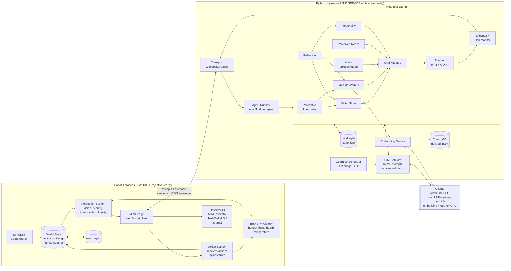
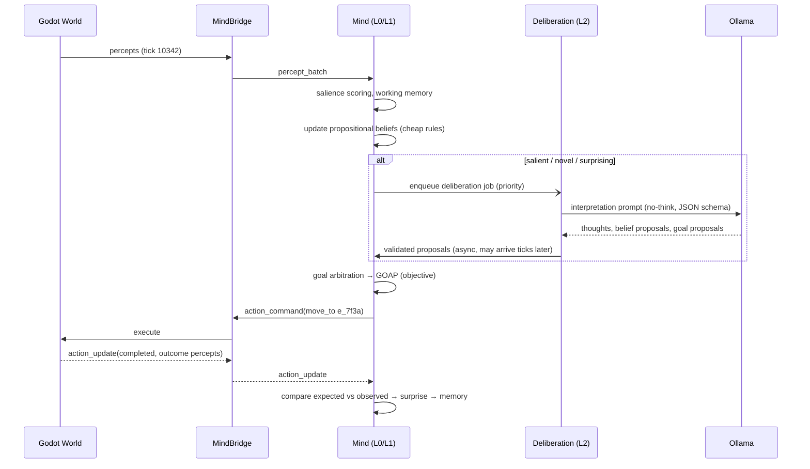

# 01 — System Architecture

## 1. Architecture diagram



**The boundary is the point of the design.** Everything left of the WebSocket
is truth. Everything right of it is opinion. The only thing that travels right
is `Percept`s, and the only thing that travels left is `ActionCommand`s (plus
read-only debug telemetry for the inspector UI).

## 2. Process model

| Process | Responsibility | Lifecycle |
|---------|----------------|-----------|
| **Godot** (`godot/`) | Rendering, world truth, physics, navigation, physiology, perception generation, action resolution, world persistence, observer UI | Starts first and launches the mind service via `OS.create_process()` (or attaches to an already-running dev instance) |
| **Mind Service** (`mind_service/`) | All cognition for all agents, mind persistence, vector index, LLM orchestration | Long-running asyncio server on `127.0.0.1:8765` |
| **Ollama** | Model inference + embeddings | External daemon, `127.0.0.1:11434` |

Godot can also run headless (`--headless`) for soak tests and faster-than-real-time
simulation of many in-game days.

## 3. Time model

- **Tick** = 1 in-game minute (configurable). Godot's `SimClock` is the master.
- Speeds: `pause`, `1×` (1 game-min per real second, so a day takes 24 real
  minutes), `4×`, `16×`, and `max` (headless).
- **Time dilation policy:** if a mind's *L1 reactive* layer falls more than N
  ticks behind, Godot slows the clock. **L2/L3 lag never slows time**: the body
  keeps acting on its current intention, and thoughts arrive late the way real
  thoughts do. An optional `strict_cognition` mode pauses time during every LLM
  call, for debugging and deterministic replays.
- Every message carries `tick`, so stale actions can be detected and discarded.

## 4. Communication flow

### 4.1 Envelope

```json
{
  "v": 1,
  "type": "percept_batch",
  "msg_id": "01J9Z…",
  "agent_id": "a_0001",
  "tick": 10342,
  "payload": { }
}
```

### 4.2 Message catalogue

| Direction | Type | Purpose |
|-----------|------|---------|
| G→M | `hello` / M→G `hello_ack` | Version negotiation, save-slot path, world seed, tick |
| G→M | `agent_spawned` / `agent_despawned` | Lifecycle (multi-agent ready) |
| G→M | `tick` | Clock heartbeat (batched: every N ticks) |
| G→M | `percept_batch` | Visual, auditory, interoceptive, and proprioceptive percepts since the last batch |
| G→M | `action_update` | `started` / `progress` / `completed` / `failed` / `interrupted` + **observed outcome as percepts** |
| M→G | `action_command` | One primitive action with params and a `plan_step_id` |
| M→G | `action_cancel` | Abort the current action |
| M→G | `mind_telemetry` | Observer UI only (character panel, inspector): the mind's self-report, covering activity, thought, goal, mood, perceived needs, traits, self-assessed skills, top beliefs. **Never consumed by world logic.** |
| G→M | `save_request` / M→G `save_ready` | Coordinated save (see `06-data-architecture.md §5`) |
| M→G | `belief_power` | The single scalar feeding DivinitySystem (ADR-014); sent once per in-game hour |

Acts of God never travel to the mind as messages. They change the world, and
the mind perceives the consequences like anything else. Dreams arrive as
`modality: dream` percepts and recollections as `modality: recollection`
(see `09-divinity-knockout-lore.md`).
| both | `ping`/`pong`, `error` | Health |

### 4.3 Percept shape (no truth leakage)

```json
{
  "percept_id": "p_88123",
  "modality": "vision",
  "handle": "e_7f3a",
  "fidelity": "look",
  "distance_m": 14.2,
  "bearing_deg": 71,
  "appearance": {
    "category_hint": "structure",
    "descriptors": ["tall", "metal", "rusted", "on four legs", "ladder"],
    "condition_cues": ["heavy rust streaks", "ladder rungs missing near top"]
  },
  "light_level": 0.8,
  "weather": "overcast"
}
```

Interoception example: `{"modality":"interoception","signal":"thirst","intensity":0.72,"quality":"dry mouth, headache"}`.

Action outcome example: `{"modality":"proprioception","event":"surface_gave_way","severity":0.6}`
plus a separate `{"modality":"interoception","signal":"pain","location":"left_leg","intensity":0.5}`.
The mind is **never** told "bridge.unsafe = true". It experiences falling.

### 4.4 Sequence: one perceive-think-act cycle



## 5. Python service architecture

### 5.1 Stack
Python 3.12, `asyncio`, `websockets`, `pydantic` v2 (protocol and LLM schemas),
`aiosqlite` (or `sqlite3` in a dedicated writer thread), `chromadb` (persistent
client), `httpx` against the Ollama REST API (`/api/chat` with `format` set to
a JSON schema, and `/api/embed`), `jinja2` for prompt templates, `structlog`,
`pytest` + `hypothesis`.

### 5.2 Layering

```
transport/        WebSocket server, envelope codec, protocol models (pydantic)
runtime/          AgentRuntime registry, per-agent Mind lifecycle, tick fan-out
scheduler/        CognitiveScheduler: priority queue of L2/L3 jobs, token budget, LOD
cognition/        Pure domain logic. No I/O except via injected ports.
  perception/     interpreter, salience, working memory
  beliefs/        store, revision (log-odds), contradiction, propositions
  memory/         encoder, retrieval scorer, consolidation, forgetting
  affect/         appraisal (OCC-lite), emotions, mood
  needs/          perceived needs, drive urgency curves
  personality/    traits, drift rules
  goals/          generation, arbitration, lifecycle (BDI commitment)
  planning/       HTN decomposition, GOAP A*, belief→symbolic projection
  execution/      executor, plan monitor, expectation checks
  reflection/     daily reflection, journal, triggered reflection
  skills/         perceived proficiency, practice tracking
llm/              Gateway, providers (ollama), model router, prompt registry,
                  output schemas, groundedness validator, call recorder
embeddings/       Embedding provider + versioning
storage/          SQLite connection, migrations, repositories, outbox,
                  vector index adapter (Chroma)
observability/    structured logs, metrics, LLM call ledger, replay
```

**Ports & adapters:** `cognition/` depends only on interfaces (`BeliefRepo`,
`MemoryRepo`, `LLMPort`, `VectorIndexPort`, `Clock`). This lets the whole mind
be unit-tested against a fake world and a scripted fake LLM. That is the single
most important testability decision.

### 5.3 LLM Gateway

- **Purposes** (each has a prompt template, an output JSON schema, a token
  budget, a model route, and a timeout):
  `interpret_percepts`, `inner_thought`, `propose_goals`, `decompose_project`,
  `explain_failure`, `daily_reflection`, `journal_entry`, `consolidate_memories`.
- **Router:** see §6 for the hardware-specific routes. The provider is an
  interface, so Llama, DeepSeek, or larger Qwen models drop in as config when
  hardware allows.
- **Structured output:** Ollama `format: <json-schema>`, then pydantic
  validation, then the **groundedness validator** (every referenced handle must
  exist in the agent's known entities; predicates must be registered), then a
  single repair retry, then drop and log.
- **Determinism and replay:** every call is recorded (`llm_calls` table) with
  the prompt hash, model digest, seed, and response. Replay mode serves
  responses from the ledger.
- **Prompt versioning:** templates live under `llm/prompts/<purpose>/v{n}.j2`.
  The version is stored with every derived belief, memory, and journal entry.

### 5.4 Cognitive Scheduler

A single priority queue shared by all agents:

```
priority = base(purpose) × agent_attention_weight × salience × staleness_boost
```

- **Budget:** tokens per in-game hour, per agent and globally, derived from the
  measured Ollama throughput.
- **Cognitive LOD (for many agents):** `focus` (camera or inspector target)
  gets full L2; `active` gets L2 for high-salience events only; `background`
  gets L1 plus L3 at sleep only.
- **Coalescing:** multiple pending interpretation jobs for one agent merge into
  one call.
- **Preemption:** a survival-critical L1 event never waits on L2. L2 results
  that arrive stale (their premise beliefs have changed since) are re-validated
  before they are applied.

### 5.5 Concurrency & consistency
- One **writer task per database** (SQLite allows a single writer; WAL mode lets
  readers run concurrently).
- Each Mind processes its own inbox serially (actor model). No locks inside
  cognition.
- The Chroma index is updated by an **outbox worker** after the SQLite commit,
  so it is eventually consistent and safe to lose.

## 6. Model plan for the target hardware (RTX 5060 Ti, 8 GB VRAM)

### 6.1 VRAM budget (estimates; Phase 0 benchmarks replace them)

| Component | VRAM |
|-----------|------|
| Godot 2D renderer | ~0.3–0.5 GB |
| `qwen3:8b` Q4_K_M weights | ~5.2 GB |
| KV cache, 8k context, `q8_0` (Ollama flash attention on) | ~0.6 GB |
| CUDA/runtime overhead + headroom | ~0.8 GB |
| Embedding model | **0** (runs on CPU via `num_gpu: 0`) |
| **Total** | **~7 GB of 8** |

Ollama settings: `OLLAMA_FLASH_ATTENTION=1`, `OLLAMA_KV_CACHE_TYPE=q8_0`,
`OLLAMA_MAX_LOADED_MODELS=1`, `num_ctx=8192`, and a long `keep_alive` so the
model is never unloaded mid-day.

### 6.2 Routes

| Purpose | Model | Mode |
|---------|-------|------|
| `interpret_percepts`, `inner_thought`, `propose_goals`, `explain_failure` | `qwen3:8b` | thinking **off**, JSON schema |
| `decompose_project` | `qwen3:8b` | thinking on, short budget |
| `daily_reflection`, `journal_entry`, `consolidate_memories` | `qwen3:8b` thinking on (**default**) or `qwen3:14b` with CPU offload (**"deep sleep" option**) | Runs while the survivor sleeps. The sim time-dilates the night if needed, so slow output is acceptable. |
| Embeddings | `qwen3-embedding:0.6b` (or `nomic-embed-text`) | CPU |
| World generation (lore prose, once) | `qwen3:14b` with offload | Offline, no time pressure |
| Phase 4 background agents | `qwen3:4b` | Cheaper L2 for low-LOD minds |

The night shift batches all of a day's L3 work into one model swap (8B → 14B →
8B) instead of switching back and forth.

### 6.3 Throughput budget
Planning assumption, to be validated in Phase 0: about 40–60 tokens/s
generation on 8B. A typical L2 call (~1.5k tokens in, ~250 out) takes about
5–7 s, so about **8 L2 calls per real minute**. At 1× speed (1 in-game hour =
1 real minute) that is roughly 8 deliberate thoughts per in-game hour for one
survivor, which is plenty. Phase 4 populations depend on cognitive LOD (§5.4)
and slower time scales.
