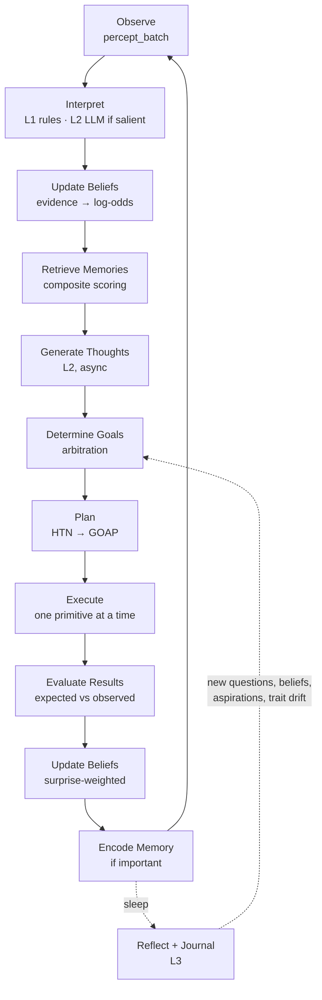
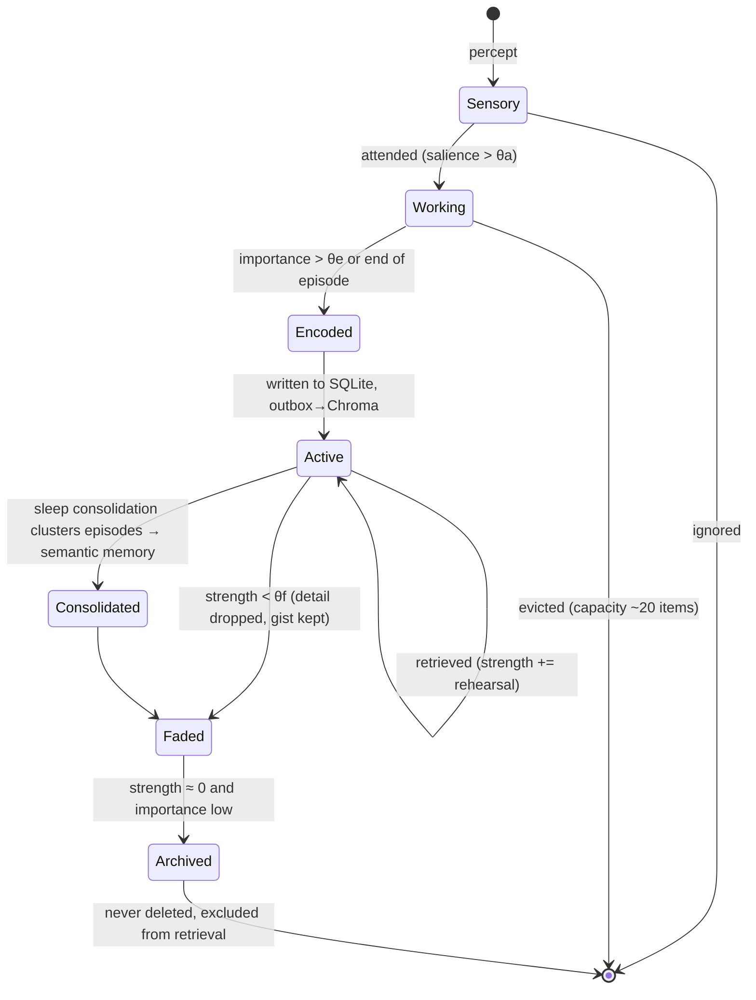

# 03 — Cognition: Loop, Needs, Personality, Emotion, Beliefs, Memory, Reflection

## 1. The cognitive loop across four time scales

The loop in the brief is preserved. Each stage is assigned to the layer that
can afford to run it.



| Stage | Layer | Cost |
|-------|-------|------|
| Observe, salience, working memory | L1 | µs–ms |
| Rule-based interpretation ("I see water" → `has(e_12, water)` at 0.5) | L1 | ms |
| LLM interpretation of novel or ambiguous scenes | L2 | seconds, async |
| Belief update from evidence | L1 | ms |
| Memory retrieval | L1 (vector + SQL) | 10–50 ms |
| Thoughts | L2 | seconds, async |
| Goal arbitration | L1 | ms |
| Goal *proposal* (new aspirations and projects) | L2/L3 | seconds |
| GOAP | L1 | ≤ 20 ms budget |
| Evaluate, surprise, memory encoding | L1 | ms |
| Reflection, journal, consolidation, trait drift | L3 | tens of seconds, during sleep |

**Triggers for L2** (each enqueues a job with a salience score): a first sight
of a new entity class, surprise > θ, a failed action, a strong emotion spike, a
goal completed or abandoned, idle time with needs satisfied (daydreaming and
planning), an open question becoming relevant.

**Triggers for L3:** falling asleep (daily), near-death, the discovery of a
document, surprise far above θ (an "epiphany").

## 2. Needs system

The body holds the true values (Godot). The mind holds **perceived needs**
built from interoception.

| Need | Tier | Fed by | Notes |
|------|------|--------|-------|
| Thirst | Survival | interoception | Fastest decay; dehydration also affects cognition (raises L2 noise) |
| Hunger | Survival | interoception | |
| Fatigue | Survival | interoception | Sleep is forced past a threshold |
| Health | Survival | pain/injury percepts | Injury location matters to actions |
| Warmth | Survival | thermal percepts | Weather + shelter + fire + clothing |
| Safety | Security | **beliefs** (threats, shelter quality, unknown dark areas) | Partly cognitive |
| Comfort | Wellbeing | shelter, rest quality, cleanliness | |
| Purpose | Growth | **computed**: rises when survival is satisfied and no meaningful project is active; falls when progress is perceived on self-chosen projects | The engine of long-term goals |

**Urgency** is a response curve per need, not a linear value:

```
urgency(need) = curve_need(deficit) × tier_weight × personality_mod
tier_weight: Survival 1.0 | Security 0.7 | Wellbeing 0.45 | Growth 0.3
```

"Survival always outweighs development" is enforced by **tier gating**: a goal
from a lower tier preempts any higher-tier goal once its urgency exceeds 0.6.
It is not just a bigger number.

`Purpose` is the most important design element for emergence. There is no
"restore town" goal. Instead, when the survivor is fed, watered, warm, and
safe, `Purpose` grows until the mind must *find something meaningful to do*.
What counts as meaningful comes from beliefs, personality, and reflection.

## 3. Personality system

| Trait (0..1) | Influences |
|--------------|-----------|
| Curiosity | Weight of info-gathering actions; L2 daydream frequency; tolerance of open questions |
| Discipline | Commitment strength; routine formation; plan adherence when uncomfortable |
| Creativity | Number and novelty of goal proposals; willingness to use items for unintended purposes |
| Risk Tolerance | Risk cost multiplier in GOAP; minimum confidence before acting on a belief |
| Persistence | Retries before abandoning; failure → frustration conversion rate |
| Empathy | (Phase 4) weight of others' needs; now: emotional response to traces of past townspeople |
| Patience | Willingness to choose long plans; tolerance for waiting (crops, drying wood) |
| Adaptability | Belief revision speed (learning rate); speed of routine change |

Each trait stores `value`, `baseline`, and `plasticity`. **Drift rules** are
deterministic and evidence-based:

```
Δtrait = plasticity × Σ(tagged_experience_effect) − elasticity × (value − baseline)
clamped to ±0.02 per in-game week
```

For example, repeated `success_under_risk` raises Risk Tolerance, and a
`failure_after_shortcut` ×3 raises Discipline. Every change is written to
`personality_history` along with the memories that caused it. Over in-game
years, `baseline` itself drifts slowly. That is identity formation.

## 4. Affect: emotion and mood

- **Appraisal (OCC-lite):** each evaluated event is appraised against active
  goals, needs, and beliefs along *desirability*, *expectedness*, *agency*, and
  *certainty*. The result is discrete emotions: hope, fear, joy, distress,
  relief, disappointment, frustration, pride, shame, curiosity/interest,
  loneliness, awe, despair.
- **Emotion state:** intensities that decay exponentially (half-life per
  emotion).
- **Mood (PAD):** valence, arousal, and dominance, as a slow moving average of
  emotions, biased by personality.
- **Beliefs → emotion:** beliefs carry `emotional_weight` and `valence`.
  Activated beliefs with high weight contribute to mood ("the town can be
  restored" → hope; "the town is beyond repair" → despair).
- **Emotion → cognition:**
  - Fear raises the risk-cost multiplier and the safety need.
  - Hope raises the utility of long-horizon projects.
  - Despair lowers Purpose regain and can make the agent abandon a project
    (realistic giving-up).
  - Frustration raises replanning and alternative-seeking.
  - Mood is injected into every LLM prompt as inner state and colours the
    journal.

## 5. Belief system

### 5.1 Representation

```json
{
  "belief_id": "b_01J9ZK…",
  "agent_id": "a_0001",
  "kind": "proposition",
  "subject": "e_7f3a",
  "predicate": "contains",
  "object": {"resource": "water", "usable": true},
  "description": "The water tower likely contains usable water",
  "confidence": 0.72,
  "source": {"type": "inference", "ref": "llm_call:8812"},
  "emotional_weight": 0.3,
  "valence": 0.6,
  "status": "active",
  "flags": ["hypothesis"],
  "created_tick": 10342,
  "updated_tick": 10342,
  "last_verified_tick": null,
  "revision": 1,
  "supporting_evidence": ["ev_…"],
  "contradicting_evidence": []
}
```

- `kind = proposition` → `predicate` must be in `predicates.yaml`. The planner
  can use it.
- `kind = narrative` → `predicate = null`. Free text, used by the LLM only.
- `status ∈ {active, superseded, refuted, dormant, uncertain}`.
- `flags`: `hypothesis`, `assumption`, `contradicted`, `outdated_suspect`,
  `core` (identity-level).

### 5.2 Predicate vocabulary (sample `predicates.yaml`)

```yaml
located_at:        {args: [entity, place],     planner: true}
contains:          {args: [entity, resource],  planner: true}
condition:         {args: [entity_part, level], planner: true}   # ruined..enhanced
safe_to_traverse:  {args: [entity],            planner: true}
provides:          {args: [entity, affordance],planner: true}   # shelter, storage, water
requires_for_repair: {args: [entity_part, resource, qty], planner: true}
edible:            {args: [item],              planner: true}
potable:           {args: [source],            planner: true}
useful_for:        {args: [entity, purpose],   planner: false}  # subjective
inhabited:         {args: [entity],            planner: true}
dangerous:         {args: [entity|place],      planner: true}
```

The vocabulary is versioned. New predicates require a migration. The LLM can
**never** coin a planner predicate. Anything that does not fit becomes a
narrative belief.

### 5.3 Formation

| Source | Base confidence | Cap | Example |
|--------|-----------------|-----|---------|
| `observation` (inspect) | 0.8 | 0.97 | "The tank is empty" (looked inside) |
| `observation` (look/glance) | 0.5 | 0.8 | "The bridge looks stable" |
| `experience` (action outcome) | 0.85 | 0.99 | "The bridge gave way under me" |
| `memory` (recalled, aged) | stored × decay | — | |
| `inference` (rules) | 0.4 | 0.65 | "Towers usually hold water" |
| `reasoning` (LLM) | 0.35 | 0.6 | "The school may be a government facility" |
| `pattern` (≥3 consistent observations) | 0.6 | 0.9 | "The stream is always clear in the morning" |
| `reflection` | 0.4 | 0.7 | "The farmhouse could become a home" |
| `testimony` (Phase 4) | trust(speaker) × 0.7 | 0.85 | |
| `seed` (starting memory) | 0.6 | — | "There is an abandoned town nearby" |

The LLM is prompted to *make assumptions frequently*. The caps ensure those
assumptions remain assumptions until the world confirms them.

### 5.4 Revision (Bayesian-flavoured, in log-odds)

```
L = logit(confidence)
L ← L + Σ polarity_i × weight_i × reliability(source_i) × adaptability_factor
confidence = clamp(sigmoid(L), floor, cap(best_source))
```

- Every revision appends to `belief_revisions`. History is never lost ("I used
  to think the tower had water").
- If confidence crosses below 0.2 with contradicting `observation` or
  `experience` evidence, the belief is marked `refuted` and a successor belief
  is created with `supersedes_belief_id`.
- **Surprise** = |expected − observed| weighted by the prior confidence. High
  surprise creates a memory with high importance, an emotional spike, and
  possibly an L2/L3 trigger. This is the learning engine.
- **Staleness:** beliefs about mutable things (contents, weather, condition)
  decay toward uncertainty since `last_verified_tick`, at a predicate-specific
  rate. "Is there still food in the store?" becomes a legitimate question.

### 5.5 Contradictions

The store indexes `(agent_id, subject, predicate)`. A new active belief with an
incompatible object creates a `belief_relations(contradicts)` row. Both may
remain active and uncertain. This is desirable: contradictions raise curiosity
and generate a **question** ("Is the bridge safe or not?") that can become an
information-gathering goal.

### 5.6 Self-beliefs and identity

Beliefs whose subject is `self` ("I am good at building", "I was probably a
mechanic") are ordinary beliefs with the `core` flag when they are stable. They
feed reflection prompts and goal proposals. Amnesia makes this the identity
formation system: the survivor builds a self-model from evidence such as skill
fluency and found documents. The world may even hold true facts about who they
were, discoverable or not.

## 6. Memory system and lifecycle



### 6.1 Memory kinds
`episodic` (events), `semantic` (generalised knowledge: "the general store has
been picked clean"), `reflection`, `journal`, `summary` (day/week/season/year),
`procedural` (skill/how-to discoveries, linked to known actions).

### 6.2 Encoding: importance

```
importance = w1·novelty + w2·|emotion| + w3·goal_relevance + w4·surprise + w5·need_relief
```

Computed without the LLM. L2 may later attach a richer summary.

### 6.3 Retrieval: composite score

```
score = α·cosine(query, memory)              (Chroma, top-N candidates)
      + β·recency  (exp decay on game time)
      + γ·importance
      + δ·strength
      + ε·emotional_congruence(current mood)
      + ζ·spatial_proximity(current location)
      + η·entity_overlap(current percept handles)
```

The query is built from the current situation: percepts, the active goal,
emotion, and location. Retrieval strengthens the retrieved memories
(rehearsal), so memories that keep being useful survive.

### 6.4 Consolidation (L3, during sleep)
1. Cluster the day's episodic memories by entity and location.
2. The LLM summarises each cluster into a semantic memory, together with
   proposed beliefs and patterns.
3. Write a day summary. Every 7 days write a week summary, then season and
   year summaries (hierarchical gist).
4. Detect patterns: the same observation N times becomes a `pattern` belief.
5. Lower the strength of episodes that were consolidated. Their gist survives
   in the semantic memory.

### 6.5 Forgetting
Strength decays as a power law: `S(t) = S0 · (1 + t/τ)^-k`, with τ scaled by
importance and emotion. A faded memory keeps its summary and drops its detail.
An archived memory stays in SQLite for debugging and analysis, but retrieval
ignores it. Phase 3 option: **reconstructive recall**, where faded memories
recalled via the LLM can acquire small distortions, recorded as a new
revision.

## 7. Reflection system

**Daily reflection (sleep, L3)** runs as a pipeline:

1. Gather the day's top memories by importance, the day's belief revisions,
   goal outcomes, the emotion arc, and open questions.
2. `daily_reflection` call → structured output:
   `insights[]`, `new_questions[]`, `belief_proposals[]`, `aspiration_proposals[]`,
   `self_assessment`, `mood_shift`.
3. Validate and ground. Apply under the same source caps (`reflection`).
4. `journal_entry` call → prose in the survivor's own voice, conditioned on the
   reflection output, the personality, and the mood. It is stored as a journal
   row **and** as a memory (the survivor can later remember what they wrote).
5. Run consolidation (§6.4) and trait drift (§3).

**Triggered reflection:** near-death, a major discovery, or a project's
completion or abandonment get a short reflection immediately.

Example of the intended output (not a template):

> *Day 17 — Patched part of the farmhouse roof today. My hands remember how to
> do this better than I remember my own name. If the rest of the roof holds,
> I could stop sleeping by the fire. I'll need more boards; the trees near the
> trail are close enough.*

The journal is the player's main window into the mind, and it doubles as a
memory and reflection substrate for the survivor.

## 8. Starting mind (`starting_mind.yaml`)

```yaml
seed_beliefs:
  - {kind: narrative, description: "I survived the night.", confidence: 0.95, flags: [core]}
  - {kind: narrative, description: "I do not remember who I am.", confidence: 0.99, flags: [core]}
  - {kind: proposition, subject: unknown_place_1, predicate: located_at,
     object: {direction: east, distance: "near"}, description: "There is an abandoned town nearby.",
     confidence: 0.6, source: seed}
procedural_knowledge:      # amnesia spares procedural memory
  - walk, look, inspect, pick_up, drop, eat, drink, sleep, build_fire_basic
personality: randomized within ranges per seed (traits.yaml)
skills: low random baselines; one or two "latent" higher skills unknown to the agent
```

Latent skills are world truth: the body is unexpectedly good at something. The
survivor discovers them through performance, which feeds identity beliefs.
