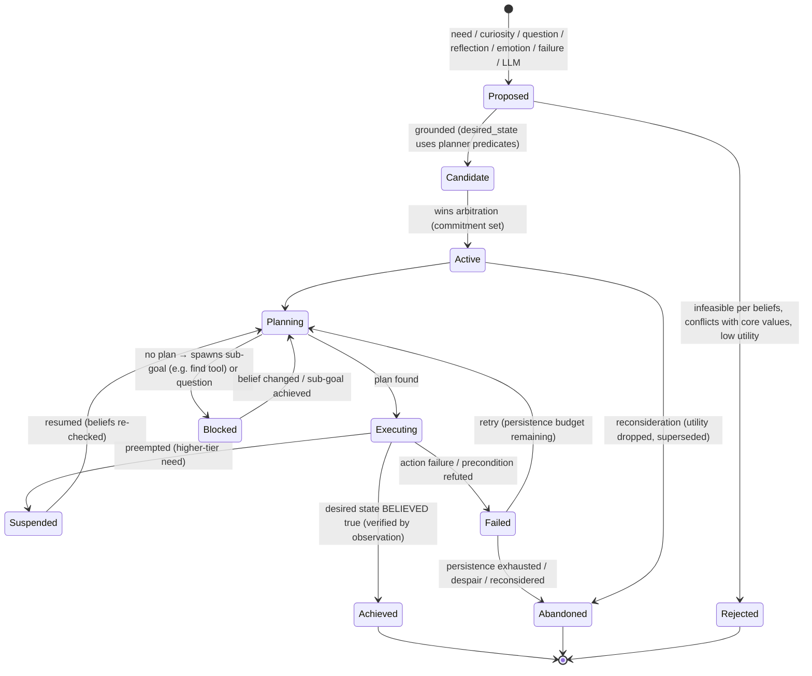

# 04 — Goals & Planning

## 1. Intention hierarchy (HTN over GOAP)

| Level | Horizon | Example | Created by | Resolved by |
|-------|---------|---------|------------|-------------|
| **Aspiration** | weeks–years | "Make a lasting home here" | L3 reflection, Purpose need | Never "completed"; strengthened or weakened |
| **Project** | days–weeks | "Make the farmhouse livable" | L2/L3 proposals grounded in beliefs | Decomposition into objectives (LLM + templates) |
| **Objective** | minutes–hours | `condition(e_farm.roof) ≥ usable` or `have(wood, 8) at e_farm` | Decomposition, needs, curiosity | **GOAP** |
| **Task** | one action | `chop(e_tree_41)` | GOAP plan step | Godot ActionRunner |

Needs produce **Objectives directly** (thirst → `perceived(thirst) < 0.3`).
Curiosity and open questions produce **information objectives**
(`known(e_7f3a.contains)` with confidence ≥ 0.8).

## 2. Goal lifecycle



Every transition writes `goal_history` and, when meaningful, a memory ("I gave
up on the water tower; the ladder was too far gone"). Abandoned goals are kept.
Reflection can revive them later ("Now that I have rope…").

### 2.1 Arbitration

```
utility(goal) = need_relevance × tier_weight
              + purpose_value × (1 − survival_pressure)
              + curiosity_value × curiosity
              + emotional_pull (hope, fear avoidance)
              + commitment_bonus (if already active; scaled by discipline)
              − expected_cost × (1 − patience·0.5)
              − risk × (1 − risk_tolerance)
              × feasibility (belief confidence of key preconditions)
```

- **BDI commitment:** an active goal is reconsidered only on significant events
  (a new need tier crossing, a refuted precondition belief, a surprise, or a
  periodic review). This prevents dithering, and routines emerge from it.
- Only **one active Objective** executes at a time (single body). Projects and
  aspirations can be active concurrently as context.

### 2.2 LLM goal proposals are grounded, not obeyed

The `propose_goals` output schema:

```json
{
  "proposals": [{
    "level": "project",
    "description": "Make the farmhouse roof keep the rain out",
    "motivation": "Sleeping outside in rain is miserable and I've been cold for days",
    "target_handles": ["e_farm"],
    "desired_state": [{"predicate": "condition", "subject": "e_farm.roof", "object": "usable"}],
    "assumptions": ["I can find enough wood near the trail"]
  }]
}
```

The validator checks that every handle is known and every predicate is
registered. `assumptions` become hypothesis beliefs and questions. If
`desired_state` cannot be grounded, the proposal is stored as an **aspiration**
that needs decomposition later, never executed directly.

## 3. GOAP planner

### 3.1 Planner state = projected beliefs

```
symbolic_state = { (subject, predicate, object) : confidence
                   for belief in active propositional beliefs
                   if confidence ≥ act_threshold(risk_tolerance, predicate) }
+ self-state (inventory as believed, perceived location, perceived needs)
```

Uncertain facts (`0.3 < c < act_threshold`) are **not** treated as true or
false. They are *unknown*, and the planner can satisfy a precondition on an
unknown fact by inserting an **information action** (`inspect`, `test_water`,
`probe_bridge`). Its cost is reduced by curiosity and raised by impatience.
This makes "go check" a real decision.

### 3.2 Action models (beliefs about actions)

`mind_service/data/action_models.yaml`, one entry per known action:

```yaml
chop_tree:
  params: [target]
  pre:   [{located_near: [self, $target]}, {is_a: [$target, tree]}, {has_tool: [self, cutting]}]
  eff:   [{have: [self, wood, +3]}]           # expected, not guaranteed
  cost:
    time_min: 40 / skill_mult(woodcutting)
    energy:   0.12
    risk:     0.03
  learnable: true                             # expected effects updated from outcomes
inspect:
  params: [target]
  pre:   [{located_near: [self, $target]}]
  eff:   [{known: [$target, "*"]}]
  cost:  {time_min: 5, energy: 0.01, risk: 0.0}
```

- **Known actions are per agent** (`known_actions` table). New ones are learned
  by discovery, for example finding a saw creates the action `saw_planks`.
- **Expected effects are learnable.** Actual yields update the agent's running
  estimate ("I usually get 2 logs, not 3"). Plans use the agent's estimate,
  not the truth.

### 3.3 Search
- Regressive A* from the goal state. The heuristic is the count of unsatisfied
  goal predicates times the minimum action cost.
- Budget: 20 ms or 2,000 node expansions, whichever comes first. If it fails,
  the goal becomes `Blocked` and produces a sub-goal or question.
- **Cost function** blends time, energy, risk × (1 − risk_tolerance), and a
  skill preference (cheaper when skilled), so personality and skills visibly
  change plans.
- **Plan caching:** successful plans are stored as *routines* with their
  context. A routine reused often gains a cost discount (habit). This is the
  mechanism for emergent routines in Phase 3.

### 3.4 Execution & monitoring
- The executor sends one `action_command` at a time.
- Before each step it re-checks the step's preconditions against **current
  beliefs**.
- On `action_update` it compares expected effects with the observed outcome
  percepts, computes surprise, and updates beliefs. If the plan's premises
  changed it replans; if the action failed it re-evaluates the goal.
- On interruption (preemption) the goal becomes `Suspended` and the plan
  remainder is kept but re-validated on resume.

## 4. Project decomposition

1. Template lookup (`decomposition_templates.yaml`, generic, for example
   "repair component X" → gather the believed required materials → transport →
   repair action). The templates encode *how a person approaches things*, not
   *what to do in this world*.
2. If no template fits, or for a novel project, `decompose_project` (LLM)
   produces an ordered list of grounded objectives with assumptions.
3. Knowledge gaps such as "I don't know what the roof needs" create a leading
   `inspect` objective. Repair requirements are discovered and only then
   planned for.

## 5. Why this produces emergence rather than scripts

- Nothing ranks buildings. Priorities come from needs (shelter → warmth),
  beliefs (what each building seems to offer), personality (a curious survivor
  explores the town hall first, a disciplined one secures water first),
  emotions, and accidents of what was perceived first.
- Failures produce beliefs and questions that reshape later goals.
- Two runs with different seeds or traits should restore the town in different
  orders, or not at all. **The scenario test suite asserts this variance.**
