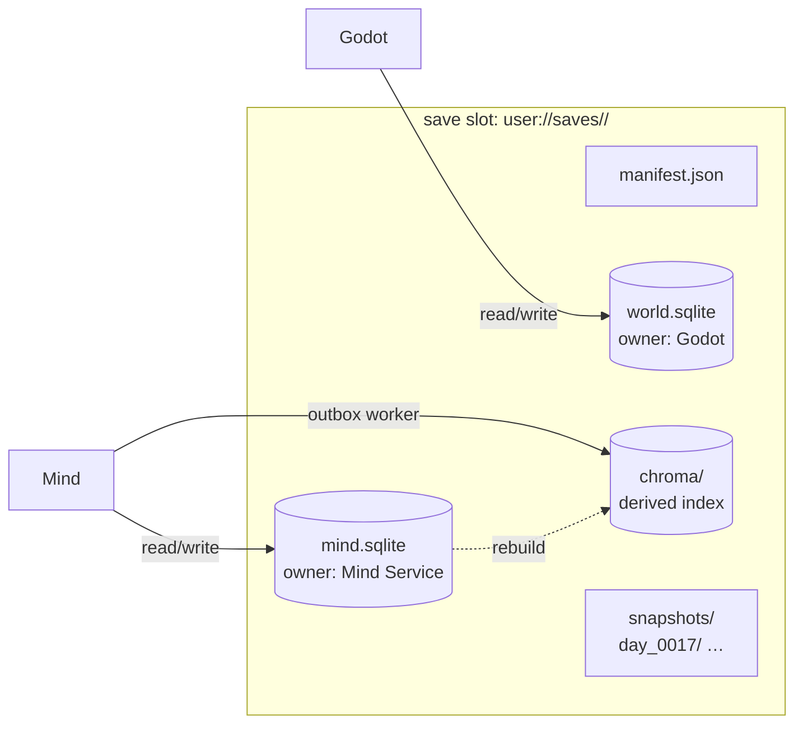
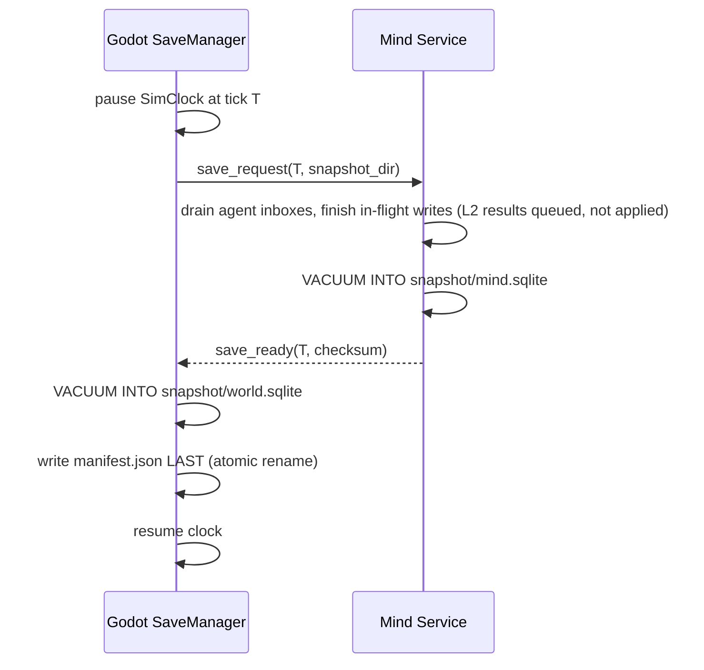

# 06 — Data Architecture: SQLite, ChromaDB, Save System

## 1. Overview



| Store | Canonical? | Owner | Contents |
|-------|------------|-------|----------|
| `world.sqlite` | ✅ | Godot (godot-sqlite) | Objective reality + world event log |
| `mind.sqlite` | ✅ | Python | All minds: beliefs, memories, goals, personality, skills (self-assessed), journal, LLM ledger |
| `chroma/` | ❌ derived | Python | Embedding vectors for memories and narrative beliefs |

Conventions for both DBs:
- `PRAGMA journal_mode=WAL; PRAGMA foreign_keys=ON;`
- IDs are **ULIDs as TEXT** (sortable, globally unique, merge-safe for future
  multi-agent imports).
- Time is stored as the integer `tick` (game minutes since epoch 0). There is
  no wall-clock time in simulation data.
- Flexible fields use JSON (`TEXT` with `json_valid` CHECK). Columns that
  queries filter on are real columns.
- `schema_migrations` table plus numbered, forward-only SQL migrations.
- **Every mind row carries `agent_id`.**

## 2. `world.sqlite` schema (objective reality)

```sql
CREATE TABLE schema_migrations (version INTEGER PRIMARY KEY, applied_at TEXT NOT NULL);

CREATE TABLE world_meta (key TEXT PRIMARY KEY, value TEXT NOT NULL);
-- keys: world_seed, current_tick, calendar_epoch, content_version

CREATE TABLE regions (
  region_id   TEXT PRIMARY KEY,
  name        TEXT NOT NULL,              -- internal name; never sent to minds
  bounds_json TEXT NOT NULL CHECK (json_valid(bounds_json))
);

CREATE TABLE entities (
  entity_id        TEXT PRIMARY KEY,      -- internal ('bld_farmhouse')
  public_handle    TEXT NOT NULL UNIQUE,  -- opaque id sent to minds ('e_7f3a')
  type_id          TEXT NOT NULL,         -- references data/definitions
  region_id        TEXT REFERENCES regions(region_id),
  parent_id        TEXT REFERENCES entities(entity_id),  -- container / building interior
  x REAL, y REAL, rot REAL,
  state_json       TEXT NOT NULL DEFAULT '{}' CHECK (json_valid(state_json)),
  created_tick     INTEGER NOT NULL,
  destroyed_tick   INTEGER
);
CREATE INDEX idx_entities_region ON entities(region_id);
CREATE INDEX idx_entities_parent ON entities(parent_id);
CREATE INDEX idx_entities_type   ON entities(type_id);

CREATE TABLE building_components (
  entity_id      TEXT NOT NULL REFERENCES entities(entity_id),
  component      TEXT NOT NULL,           -- roof, walls, foundation, door, tank…
  condition      REAL NOT NULL CHECK (condition BETWEEN 0 AND 1),
  material       TEXT,
  decay_rate     REAL NOT NULL DEFAULT 0,
  repair_recipe_json TEXT NOT NULL DEFAULT '{}',
  hidden_json    TEXT NOT NULL DEFAULT '{}', -- truths not visible by default (rot, cracks)
  PRIMARY KEY (entity_id, component)
);

CREATE TABLE building_affordances (
  entity_id   TEXT NOT NULL REFERENCES entities(entity_id),
  affordance  TEXT NOT NULL,              -- shelter, storage, water_storage, workshop
  condition_expr TEXT NOT NULL,           -- 'roof>=0.6 AND walls>=0.5'
  PRIMARY KEY (entity_id, affordance)
);

CREATE TABLE items (
  entity_id    TEXT PRIMARY KEY REFERENCES entities(entity_id),
  item_type    TEXT NOT NULL,
  quantity     REAL NOT NULL DEFAULT 1,
  quality      REAL NOT NULL DEFAULT 1,
  durability   REAL,
  hidden_json  TEXT NOT NULL DEFAULT '{}'  -- toxicity, potability, spoilage
);

CREATE TABLE resource_nodes (
  entity_id       TEXT PRIMARY KEY REFERENCES entities(entity_id),
  resource_type   TEXT NOT NULL,
  amount          REAL NOT NULL,
  max_amount      REAL NOT NULL,
  regen_per_day   REAL NOT NULL DEFAULT 0,
  last_harvest_tick INTEGER
);

CREATE TABLE documents (
  entity_id   TEXT PRIMARY KEY REFERENCES entities(entity_id),
  text        TEXT NOT NULL,
  legibility  REAL NOT NULL DEFAULT 1,
  language    TEXT DEFAULT 'en'
);

CREATE TABLE agent_bodies (               -- true physiology
  agent_id      TEXT PRIMARY KEY,
  entity_id     TEXT NOT NULL REFERENCES entities(entity_id),
  health REAL, hunger REAL, thirst REAL, fatigue REAL, body_temp REAL,
  conditions_json TEXT NOT NULL DEFAULT '[]',   -- injuries, illness
  carry_capacity  REAL NOT NULL
);

CREATE TABLE agent_true_skills (          -- determines outcomes
  agent_id TEXT NOT NULL, skill TEXT NOT NULL,
  level REAL NOT NULL, xp REAL NOT NULL, last_used_tick INTEGER,
  PRIMARY KEY (agent_id, skill)
);

CREATE TABLE weather_state (
  tick INTEGER PRIMARY KEY, kind TEXT, temperature_c REAL, wind REAL, precipitation REAL
);

CREATE TABLE world_events (               -- truth change log (append-only)
  event_id   TEXT PRIMARY KEY,
  tick       INTEGER NOT NULL,
  kind       TEXT NOT NULL,               -- component_changed, item_moved, node_harvested…
  entity_id  TEXT,
  actor_agent_id TEXT,
  payload_json TEXT NOT NULL
);
CREATE INDEX idx_world_events_tick ON world_events(tick);
```

## 3. `mind.sqlite` schema (subjective reality)

```sql
CREATE TABLE schema_migrations (version INTEGER PRIMARY KEY, applied_at TEXT NOT NULL);
CREATE TABLE mind_meta (key TEXT PRIMARY KEY, value TEXT NOT NULL);
-- keys: embedding_model, embedding_dims, predicate_vocab_version, protocol_version

-- ── Agents ──────────────────────────────────────────────────────────────
CREATE TABLE agents (
  agent_id        TEXT PRIMARY KEY,
  self_name       TEXT,                 -- chosen by the survivor, may be NULL for a long time
  created_tick    INTEGER NOT NULL,
  status          TEXT NOT NULL DEFAULT 'alive',
  cognitive_lod   TEXT NOT NULL DEFAULT 'focus',
  seed            INTEGER NOT NULL
);

CREATE TABLE agent_state (                -- hot mind state, overwritten
  agent_id         TEXT PRIMARY KEY REFERENCES agents(agent_id),
  tick             INTEGER NOT NULL,
  mood_valence REAL, mood_arousal REAL, mood_dominance REAL,
  believed_x REAL, believed_y REAL, believed_place TEXT,
  active_objective_id TEXT,
  working_memory_json TEXT NOT NULL DEFAULT '[]',
  last_reflection_tick INTEGER
);

CREATE TABLE perceived_needs (
  agent_id TEXT NOT NULL REFERENCES agents(agent_id),
  need     TEXT NOT NULL,
  value    REAL NOT NULL,                 -- perceived deficit 0..1
  urgency  REAL NOT NULL,
  updated_tick INTEGER NOT NULL,
  PRIMARY KEY (agent_id, need)
);

CREATE TABLE emotions (
  agent_id TEXT NOT NULL REFERENCES agents(agent_id),
  emotion  TEXT NOT NULL,
  intensity REAL NOT NULL,
  updated_tick INTEGER NOT NULL,
  PRIMARY KEY (agent_id, emotion)
);

CREATE TABLE personality_traits (
  agent_id TEXT NOT NULL REFERENCES agents(agent_id),
  trait    TEXT NOT NULL,
  value REAL NOT NULL, baseline REAL NOT NULL, plasticity REAL NOT NULL,
  updated_tick INTEGER NOT NULL,
  PRIMARY KEY (agent_id, trait)
);

CREATE TABLE personality_history (
  id TEXT PRIMARY KEY, agent_id TEXT NOT NULL, trait TEXT NOT NULL,
  old_value REAL, new_value REAL, tick INTEGER NOT NULL,
  reason TEXT, evidence_memory_ids_json TEXT
);

-- ── Knowledge of entities (agent's own labels) ─────────────────────────
CREATE TABLE known_entities (
  agent_id     TEXT NOT NULL REFERENCES agents(agent_id),
  handle       TEXT NOT NULL,             -- opaque, from percepts
  self_label   TEXT,                      -- "the water tower"
  kind_guess   TEXT,
  first_seen_tick INTEGER NOT NULL,
  last_seen_tick  INTEGER NOT NULL,
  last_known_x REAL, last_known_y REAL,
  appearance_json TEXT NOT NULL DEFAULT '{}',
  PRIMARY KEY (agent_id, handle)
);

CREATE TABLE places (                     -- subjective map ("the clearing by the stream")
  place_id TEXT PRIMARY KEY, agent_id TEXT NOT NULL,
  label TEXT NOT NULL, x REAL, y REAL, radius REAL,
  created_tick INTEGER NOT NULL
);

-- ── Beliefs ────────────────────────────────────────────────────────────
CREATE TABLE predicates (
  name TEXT PRIMARY KEY, arity INTEGER NOT NULL, arg_types_json TEXT NOT NULL,
  planner_usable INTEGER NOT NULL, staleness_rate REAL NOT NULL DEFAULT 0,
  vocab_version INTEGER NOT NULL
);

CREATE TABLE beliefs (
  belief_id    TEXT PRIMARY KEY,
  agent_id     TEXT NOT NULL REFERENCES agents(agent_id),
  kind         TEXT NOT NULL CHECK (kind IN ('proposition','narrative')),
  subject      TEXT,                      -- handle, place_id, 'self', or concept
  predicate    TEXT REFERENCES predicates(name),
  object_json  TEXT,
  description  TEXT NOT NULL,
  confidence   REAL NOT NULL CHECK (confidence BETWEEN 0 AND 1),
  source_type  TEXT NOT NULL,             -- observation|experience|memory|inference|reasoning|pattern|reflection|testimony|seed
  source_ref   TEXT,                      -- percept id, llm_call id, agent id
  emotional_weight REAL NOT NULL DEFAULT 0,
  valence      REAL NOT NULL DEFAULT 0,
  status       TEXT NOT NULL DEFAULT 'active',
  flags_json   TEXT NOT NULL DEFAULT '[]',
  created_tick INTEGER NOT NULL,
  updated_tick INTEGER NOT NULL,
  last_verified_tick INTEGER,
  revision     INTEGER NOT NULL DEFAULT 1,
  supersedes_belief_id TEXT REFERENCES beliefs(belief_id),
  prompt_version TEXT,
  CHECK (kind = 'narrative' OR predicate IS NOT NULL)
);
CREATE INDEX idx_beliefs_spo    ON beliefs(agent_id, subject, predicate, status);
CREATE INDEX idx_beliefs_status ON beliefs(agent_id, status, confidence);

CREATE TABLE belief_revisions (           -- append-only history
  id TEXT PRIMARY KEY, belief_id TEXT NOT NULL REFERENCES beliefs(belief_id),
  revision INTEGER NOT NULL, confidence REAL NOT NULL, description TEXT NOT NULL,
  status TEXT NOT NULL, tick INTEGER NOT NULL,
  cause_type TEXT NOT NULL, cause_ref TEXT
);

CREATE TABLE belief_evidence (
  id TEXT PRIMARY KEY, belief_id TEXT NOT NULL REFERENCES beliefs(belief_id),
  polarity INTEGER NOT NULL CHECK (polarity IN (-1, 1)),
  weight REAL NOT NULL, evidence_type TEXT NOT NULL,   -- percept|memory|belief|testimony
  evidence_ref TEXT NOT NULL, tick INTEGER NOT NULL
);
CREATE INDEX idx_evidence_belief ON belief_evidence(belief_id);

CREATE TABLE belief_relations (
  belief_a TEXT NOT NULL REFERENCES beliefs(belief_id),
  belief_b TEXT NOT NULL REFERENCES beliefs(belief_id),
  relation TEXT NOT NULL CHECK (relation IN ('contradicts','supports','derived_from')),
  tick INTEGER NOT NULL,
  PRIMARY KEY (belief_a, belief_b, relation)
);

CREATE TABLE questions (                  -- curiosity substrate
  question_id TEXT PRIMARY KEY, agent_id TEXT NOT NULL,
  text TEXT NOT NULL, about_handle TEXT, about_belief_id TEXT,
  status TEXT NOT NULL DEFAULT 'open',   -- open|answered|abandoned
  importance REAL NOT NULL, created_tick INTEGER NOT NULL, resolved_tick INTEGER,
  answer_belief_id TEXT
);

-- ── Memory ─────────────────────────────────────────────────────────────
CREATE TABLE memories (
  memory_id     TEXT PRIMARY KEY,
  agent_id      TEXT NOT NULL REFERENCES agents(agent_id),
  kind          TEXT NOT NULL,            -- episodic|semantic|reflection|journal|summary|procedural
  tick          INTEGER NOT NULL,
  day           INTEGER NOT NULL,
  x REAL, y REAL, place_id TEXT,
  summary       TEXT NOT NULL,            -- embedded text
  detail        TEXT,                     -- dropped on fade
  importance    REAL NOT NULL,
  emotion_label TEXT, emotion_valence REAL, emotion_intensity REAL,
  strength      REAL NOT NULL DEFAULT 1,
  access_count  INTEGER NOT NULL DEFAULT 0,
  last_accessed_tick INTEGER,
  status        TEXT NOT NULL DEFAULT 'active',  -- active|consolidated|faded|archived
  parent_memory_id TEXT REFERENCES memories(memory_id),   -- summary hierarchy
  summary_level TEXT,                     -- day|week|season|year (kind=summary)
  embedding_model TEXT,
  embedding_status TEXT NOT NULL DEFAULT 'pending',       -- pending|indexed|stale
  prompt_version TEXT
);
CREATE INDEX idx_mem_agent_tick   ON memories(agent_id, tick);
CREATE INDEX idx_mem_agent_status ON memories(agent_id, status, importance);

CREATE TABLE memory_entities (memory_id TEXT NOT NULL REFERENCES memories(memory_id), handle TEXT NOT NULL, PRIMARY KEY (memory_id, handle));
CREATE TABLE memory_beliefs  (memory_id TEXT NOT NULL REFERENCES memories(memory_id), belief_id TEXT NOT NULL, relation TEXT NOT NULL, PRIMARY KEY (memory_id, belief_id));
CREATE TABLE memory_goals    (memory_id TEXT NOT NULL REFERENCES memories(memory_id), goal_id TEXT NOT NULL, PRIMARY KEY (memory_id, goal_id));
CREATE TABLE memory_sources  (memory_id TEXT NOT NULL REFERENCES memories(memory_id), source_memory_id TEXT NOT NULL, PRIMARY KEY (memory_id, source_memory_id));  -- consolidation lineage

CREATE TABLE vector_outbox (              -- SQLite → Chroma, transactional
  id INTEGER PRIMARY KEY AUTOINCREMENT,
  op TEXT NOT NULL CHECK (op IN ('upsert','delete')),
  collection TEXT NOT NULL, doc_id TEXT NOT NULL,
  enqueued_tick INTEGER NOT NULL, attempts INTEGER NOT NULL DEFAULT 0, last_error TEXT
);

-- ── Goals & plans ──────────────────────────────────────────────────────
CREATE TABLE goals (
  goal_id      TEXT PRIMARY KEY,
  agent_id     TEXT NOT NULL REFERENCES agents(agent_id),
  parent_goal_id TEXT REFERENCES goals(goal_id),
  level        TEXT NOT NULL CHECK (level IN ('aspiration','project','objective')),
  description  TEXT NOT NULL,
  motivation   TEXT,
  desired_state_json TEXT,                -- grounded predicates; NULL for aspirations
  origin_type  TEXT NOT NULL,             -- need|curiosity|question|reflection|emotion|failure|belief
  origin_ref   TEXT,
  utility      REAL NOT NULL DEFAULT 0,
  commitment   REAL NOT NULL DEFAULT 0,
  status       TEXT NOT NULL,             -- proposed|candidate|active|planning|executing|blocked|suspended|achieved|failed|abandoned|rejected
  failure_count INTEGER NOT NULL DEFAULT 0,
  created_tick INTEGER NOT NULL, activated_tick INTEGER, resolved_tick INTEGER,
  resolution_note TEXT
);
CREATE INDEX idx_goals_agent_status ON goals(agent_id, status, level);

CREATE TABLE goal_history (
  id TEXT PRIMARY KEY, goal_id TEXT NOT NULL REFERENCES goals(goal_id),
  from_status TEXT, to_status TEXT NOT NULL, tick INTEGER NOT NULL, reason TEXT
);

CREATE TABLE plans (
  plan_id TEXT PRIMARY KEY, agent_id TEXT NOT NULL, goal_id TEXT NOT NULL REFERENCES goals(goal_id),
  status TEXT NOT NULL, planner TEXT NOT NULL, cost_estimate REAL,
  belief_snapshot_hash TEXT, created_tick INTEGER NOT NULL, routine_id TEXT
);
CREATE TABLE plan_steps (
  plan_step_id TEXT PRIMARY KEY, plan_id TEXT NOT NULL REFERENCES plans(plan_id),
  idx INTEGER NOT NULL, action_type TEXT NOT NULL, params_json TEXT NOT NULL,
  expected_effects_json TEXT NOT NULL,
  status TEXT NOT NULL, started_tick INTEGER, ended_tick INTEGER
);
CREATE TABLE action_outcomes (
  id TEXT PRIMARY KEY, agent_id TEXT NOT NULL, plan_step_id TEXT REFERENCES plan_steps(plan_step_id),
  action_type TEXT NOT NULL, success INTEGER NOT NULL,
  observed_json TEXT NOT NULL, surprise REAL NOT NULL, tick INTEGER NOT NULL
);

CREATE TABLE routines (                   -- emergent habits
  routine_id TEXT PRIMARY KEY, agent_id TEXT NOT NULL,
  label TEXT, context_json TEXT NOT NULL, plan_template_json TEXT NOT NULL,
  uses INTEGER NOT NULL DEFAULT 0, successes INTEGER NOT NULL DEFAULT 0,
  last_used_tick INTEGER, strength REAL NOT NULL DEFAULT 0
);

-- ── Procedural knowledge & self-assessed skills ────────────────────────
CREATE TABLE known_actions (
  agent_id TEXT NOT NULL, action_type TEXT NOT NULL,
  model_override_json TEXT NOT NULL DEFAULT '{}',  -- learned expected effects / costs
  discovered_tick INTEGER NOT NULL, source TEXT NOT NULL,
  PRIMARY KEY (agent_id, action_type)
);
CREATE TABLE perceived_skills (
  agent_id TEXT NOT NULL, skill TEXT NOT NULL,
  self_assessed REAL NOT NULL, practice_count INTEGER NOT NULL DEFAULT 0,
  last_used_tick INTEGER,
  PRIMARY KEY (agent_id, skill)
);

-- ── Expression & logs ──────────────────────────────────────────────────
CREATE TABLE journal_entries (
  entry_id TEXT PRIMARY KEY, agent_id TEXT NOT NULL, day INTEGER NOT NULL,
  tick INTEGER NOT NULL, body TEXT NOT NULL,
  mood_json TEXT NOT NULL, memory_id TEXT REFERENCES memories(memory_id),
  llm_call_id TEXT, prompt_version TEXT
);
CREATE TABLE thoughts (
  thought_id TEXT PRIMARY KEY, agent_id TEXT NOT NULL, tick INTEGER NOT NULL,
  text TEXT NOT NULL, trigger TEXT, llm_call_id TEXT
);
CREATE TABLE agent_events (               -- experienced-event log (append-only)
  event_id TEXT PRIMARY KEY, agent_id TEXT NOT NULL, tick INTEGER NOT NULL,
  kind TEXT NOT NULL, payload_json TEXT NOT NULL
);
CREATE INDEX idx_agent_events ON agent_events(agent_id, tick);

CREATE TABLE llm_calls (                  -- ledger for replay & analysis
  llm_call_id TEXT PRIMARY KEY, agent_id TEXT, tick INTEGER NOT NULL,
  purpose TEXT NOT NULL, model TEXT NOT NULL, model_digest TEXT,
  prompt_version TEXT NOT NULL, prompt_hash TEXT NOT NULL, seed INTEGER,
  request_json TEXT NOT NULL, response_json TEXT,
  valid INTEGER NOT NULL, error TEXT,
  tokens_in INTEGER, tokens_out INTEGER, latency_ms INTEGER
);

-- ── Phase 4 (created now, empty until used) ────────────────────────────
CREATE TABLE social_models (              -- what A believes about B
  agent_id TEXT NOT NULL, other_agent_handle TEXT NOT NULL,
  trust REAL, affinity REAL, familiarity REAL, respect REAL,
  updated_tick INTEGER NOT NULL,
  PRIMARY KEY (agent_id, other_agent_handle)
);
```

`llm_calls.request_json` grows quickly. Rotate it into `llm_ledger_<year>.sqlite`
attached databases after each in-game season.

## 4. ChromaDB design

| Collection | Doc id | Document | Metadata |
|------------|--------|----------|----------|
| `memories_v{N}` | `memory_id` | `memories.summary` | `agent_id, kind, day, tick, importance, place_id, emotion_valence, status` |
| `narrative_beliefs_v{N}` | `belief_id` | `beliefs.description` | `agent_id, status, confidence, source_type` |

- `N` = embedding-schema version. Changing the embedding model means creating
  `_v{N+1}`, backfilling from SQLite, and switching over. Old saves keep
  working because the index is reproducible.
- **Embeddings are computed by the Mind Service** via Ollama (`qwen3-embedding`
  or `nomic-embed-text`) and passed explicitly, never through Chroma's default
  embedding function. The model name and dimensions are stored in
  `mind_meta` and in the collection metadata.
- Distance: cosine (`hnsw:space = cosine`).
- **Queries always filter `agent_id`** (no cross-agent leakage) and usually
  `status != archived`. Chroma returns top-N (≈40) candidates, and the Python
  re-ranker applies the composite score (§03 6.3) using SQLite fields.
- **Integrity:** on startup, compare SQLite counts of `embedding_status =
  'indexed'` against Chroma counts. If they differ, reindex the delta.
  `tools/reindex_memories.py` does a full rebuild.
- Scale: a single collection with metadata filtering handles hundreds of
  agents × 100k memories. Partition by `agent_id` shard (collection per 50
  agents) only if profiling demands it.

## 5. Save system

### 5.1 Model: always-persisted world + checkpoints

This is a persistent world. Both databases write continuously, so the live
slot *is* the save. "Saving" means creating a **consistent checkpoint**.

```
user://saves/<slot>/
  manifest.json
  world.sqlite        mind.sqlite        chroma/
  snapshots/
    day_0017/  manifest.json  world.sqlite  mind.sqlite     # chroma omitted: rebuildable
```

`manifest.json`:

```json
{
  "format_version": 1,
  "slot": "forest-01",
  "created_utc": "…", "updated_utc": "…",
  "tick": 24480, "day": 17,
  "world_schema": 3, "mind_schema": 5, "protocol": 1,
  "predicate_vocab": 2, "content_version": "0.3.0",
  "embedding": {"model": "qwen3-embedding:0.6b", "dims": 1024, "collection_version": 1},
  "agents": ["a_0001"],
  "checksums": {"world.sqlite": "sha256:…", "mind.sqlite": "sha256:…"}
}
```

### 5.2 Coordinated checkpoint protocol



- `VACUUM INTO` produces a consistent, compacted copy while WAL readers
  continue.
- A snapshot without a manifest is incomplete and ignored. That makes the
  protocol crash-safe.
- **Autosave** happens at each sleep (end of day), after L3 reflection. Keep
  the last 7 daily, 8 weekly, and every seasonal snapshot.

### 5.3 Longevity ("years of progression")
1. **Forward-only migrations** in both DBs, run on load, after which the
   manifest is updated.
2. **Content versioning:** entity type definitions are versioned. Removed types
   map to `legacy_*` fallbacks, never a crash.
3. **Predicate vocabulary** is versioned with migration maps (rename or split).
4. **Embedding independence:** the index can always be rebuilt.
5. **Growth control:** memory consolidation, ledger rotation, and archive tables.
   Target: under 500 MB per agent per in-game year.
6. **Golden save tests:** CI loads saves from every released version.
