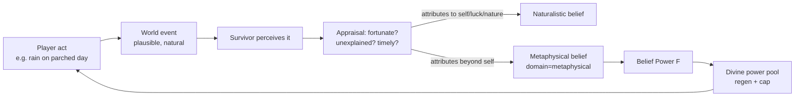

# 09 — Acts of God, Knockouts, and the Hidden Past

Three systems added after review round 1. All three serve one rule:

> **The survivor must believe everything is real.** Nothing it perceives may
> reveal that it is simulated, observed, or controlled.

## 0. The reality guard (cross-cutting)

- **Prompts** are written as first-person inner life. They never mention
  simulation, games, players, NPCs, code, quests, or "the developer".
- **Output filter:** every LLM output (thoughts, journal, beliefs, goals) passes
  a *meta-awareness check*. A term blocklist runs first, then a cheap
  classifier pass on any text the blocklist flags. Rejected outputs are
  regenerated once and then dropped. Every rejection is logged
  (`llm_calls.error = 'meta_awareness'`) so that we can find the prompts that
  leak.
- **Diegetic world:** no UI text, labels, or numbering inside the world. Clues
  are letters, photos, and objects, never "Clue 3/12".
- **Metaphysical beliefs are allowed.** "Something watches over me" is a real
  human belief. "A player is controlling the weather" is not, and the filter
  rejects it.

## 1. Acts of God (limited by belief power)

### 1.1 Concept
The player is an unseen higher power. The power available to the player grows
and shrinks with **how much the survivor believes in something beyond
themselves**. That belief is not a slider. It emerges from the survivor's own
beliefs, which the player's acts can influence.



### 1.2 Belief Power (computed by the Mind Service)

```
F = Σ  confidence(b) × (0.5 + emotional_weight(b)) × stance(b)
    over active beliefs with domain = 'metaphysical'
  + Σ  attribution_memory_strength (last 30 in-game days, decayed)
stance ∈ {+1 benevolent/present, 0 unsure, −0.5 hostile/absent "nothing is out there"}
F_norm = clamp(F / F_scale, 0, 1)
```

- **Attribution** is the key event. When the mind appraises an outcome as
  fortunate (positive valence), unexplained (no self-agency, low expectedness),
  and timely (it relieved an urgent need), the L2 interpretation may attribute
  it beyond the self. Receptivity rises with creativity and adaptability, and
  with distress or despair ("foxhole effect"). A highly rational survivor may
  just say "lucky".
- **Faith can fall.** If the survivor forms an expectation ("if I ask, help
  comes") and nothing happens, that is contradicting evidence under normal
  belief revision.
- **Prayer emerges, it is not given.** A `pray` / `ask_for_help` action becomes
  a *known action* only after a metaphysical belief with confidence above 0.4
  exists. The inspector shows prayers to the player, which closes a genuine
  feedback loop between the two of you.
- **Boundary exception (ADR-014):** this is the *only* place where mind state
  affects world rules. Exactly one scalar (`belief_power`) flows from the mind
  service to Godot's `DivinitySystem` through telemetry. The world still never
  sends truth to the mind.

### 1.3 Power pool

```
pool_cap   = base_cap + cap_scale × F_norm
regen/day  = base_regen + regen_scale × F_norm
```

The small `base_cap` means that even with zero faith the player can do Tier 0
acts. Without it there would be a chicken-and-egg problem.

### 1.4 Act catalogue (data-driven, `godot/data/divinity/acts.tres`)

| Tier | Min F | Examples | Overtness |
|------|-------|----------|-----------|
| 0 Whisper | 0.0 | Send a **dream motif**; a bird calls; a breeze toward something; a glint (raises the salience of an already-visible entity) | Invisible |
| 1 Nudge | 0.15 | Light rain; clear the sky; a small animal crosses the path; a fallen branch (firewood) | Natural |
| 2 Providence | 0.35 | Spawn a plausible item in an *unobserved, uninspected* spot; shift a storm's path; ease a fever | Lucky |
| 3 Sign | 0.6 | Lightning fells a tree; wind blows open a stuck door; a **vision dream** of a place not yet seen | Uncanny |
| 4 Miracle | 0.85 | Heal an injury overnight; a clear sign in the sky | Overt |

**World rules still apply.** Every act is validated by Godot:
- It must be physically plausible for the region and season (no car parts
  falling from the sky).
- Item spawns go only where the agent has no line of sight and has not
  inspected in the last N days (the world tracks inspections as truth). This
  needs no read of the mind.
- **Lore protection:** acts may never create, alter, or directly reveal lore
  facts. At Tier 3 they may *uncover access* to an existing clue (the wind
  opens a door), never place one.
- Cooldowns per act. Repeating the same act decays its effect on attribution,
  because people habituate.

### 1.5 Dreams
Dream acts arrive during sleep as `modality: dream` percepts carrying a motif
(symbol, feeling, an entity the survivor has seen, or, as a Tier 3 vision, an
unseen place). L3 reflection weaves them into the journal. Beliefs from dreams
use source `dream`, capped at 0.3 confidence. Dreams inspire questions and
feelings, not facts.

## 2. Knockouts (no death)

### 2.1 World side (truth)

| Trigger | Health ≤ 0, or a hypothermia, dehydration, or exhaustion collapse threshold |
|---|---|
| Body | Enters `unconscious`. The clock skips 4–10 h, longer for repeated knockouts. |
| Relocation | Body wakes at its **last resting place** (truth-tracked: where it last slept) |
| Restoration | Health → 0.5. Hunger and thirst set to "uncomfortable but safe" (prevents knockout loops). Residual fatigue and stiffness. |
| World | **Is not rewound.** A collapsed bridge stays collapsed. Items dropped at the scene stay there. |
| Logging | `world_events(kind='knockout')`, and `agent_bodies.knockout_count` for escalation |

Not rewinding is a deliberate choice. A persistent world that rewinds breaks
causality for every system, including Phase 4's other agents. It also creates
the best uncanny moments.

### 2.2 Mind side: "it was just a bad dream"
Godot never tells the mind "you were knocked out." It sends only waking
percepts: `{"modality":"interoception","signal":"waking","quality":"heart pounding, cold sweat, vivid fragments"}`
plus normal vision of the bed or campsite.

The mind's **nightmare reframing rule** (deterministic, `cognition/memory/reframing.py`):
1. Window = memories from `min(last wake-up, blackout − 60 min)` to the
   blackout.
2. Those memories get `reality_status = 'dream'` and their detail fragments.
3. Beliefs whose supporting evidence lies **only** inside the window are capped
   at 0.3, with source `dream`.
4. Emotional residue is kept at about 50%. The survivor may avoid the bridge
   without knowing exactly why.
5. The journal treats it as a nightmare.

### 2.3 Dissonance is a feature
Later the survivor sees the bridge actually broken, or finds their axe lying
beside it. That is contradicting evidence against "it was a dream", which
produces a question ("Was it real?"). The memories can be promoted to
`reality_status = 'uncertain'` and then back to `real`. This is ordinary belief
revision producing a genuinely eerie experience, and it echoes the opening
amnesia ("I survived the night").

## 3. The hidden past (lore)

### 3.1 Truth model
Generated **once at world creation** and stored only in `world.sqlite`:

- **Lore facts:** who the survivor was (name, profession, why they came here,
  relationships), and what happened to the town. Facts are tiered `core`,
  `major`, or `minor`.
- **Consistency with the body:** the backstory determines latent skills (a
  former mechanic is unexpectedly good at Repair), the starting campsite items,
  and physical details. The body is itself a clue.
- **Clues:** physical, diegetic entities (letters, a photo, a work jacket with
  a name patch, a ledger, a cassette tape, carved initials, a locked safe).
  Each carries *fragments* of one or more facts, with ambiguity.
- **Red herrings:** belongings of other former residents that plausibly look
  like they could be the survivor's (another mechanic's name tag).
- **Recollections:** triggers (an entity, a place, a smell, a sound) that,
  under conditions (familiarity, emotion, sleep), fire a `modality:
  recollection` percept. These are sensory, never declarative ("the smell of
  motor oil; someone laughing; a blue door"). Source `recollection`, capped at
  0.7.

### 3.2 Making it really hard

| Knob | Default |
|------|---------|
| Independent fragments needed before a core fact can exceed 0.7 confidence (enforced by belief math, since each fragment is weak evidence) | 3–5 |
| Total clues for the full identity | 20–30, spread over all 5 buildings, the forest, the trail |
| Red herring ratio | ~25% of identity-looking clues |
| Access gates | locked (key elsewhere), behind repair (cellar under rubble, tower top), needs power (tape player needs batteries; old computer needs generator + fuel), needs time (a water-damaged diary is readable only after drying), needs reasoning (safe combination split across items) |
| Legibility | Damaged documents reveal partial text, more with patience and inspection time |

The gates mean **discovering the past is tangled up with restoring the world**,
with no quest linking them. A survivor who never repairs the garage roof never
reaches the tape in the loft.

### 3.3 Generation pipeline (`worldgen/`, world-side only)
1. Choose a backstory skeleton from authored templates using the world seed.
2. Fill in specifics (names, dates, relationships) consistently.
3. The LLM writes document prose **constrained to an explicit fact list**,
   offline and slowly at world creation.
4. Validator: a second LLM pass plus entity and keyword checks, to make sure
   the prose leaks no extra facts and has no contradictions.
5. A clue placement solver assigns clues to locations and gates while meeting
   difficulty constraints (gate depth, spread, and minimum distance between
   corroborating fragments).

`worldgen/` writes only to `world.sqlite`. CI forbids `mind/` from importing it
(import-linter rule), because lore is truth.

### 3.4 Developer-only measurement
`identity_reconstruction_score` = the share of core facts the survivor believes
correctly at a confidence of at least 0.7, minus confidently-held wrong core
beliefs. It is shown only in the Truth/Belief Diff view.
