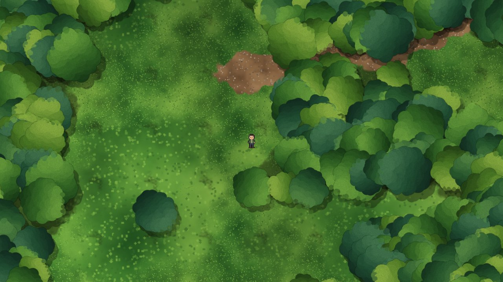
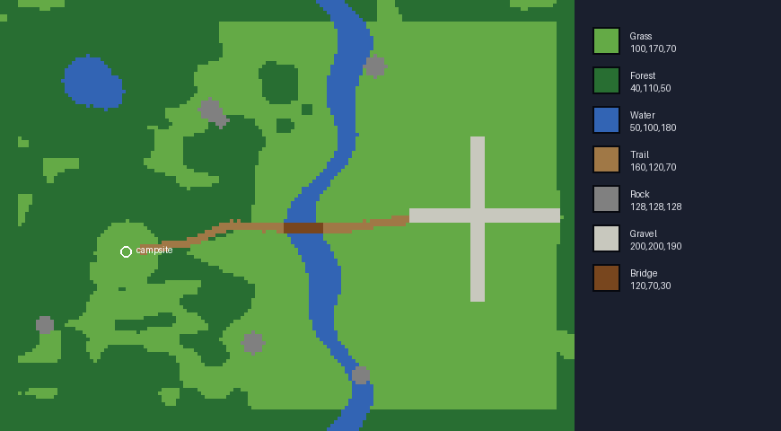
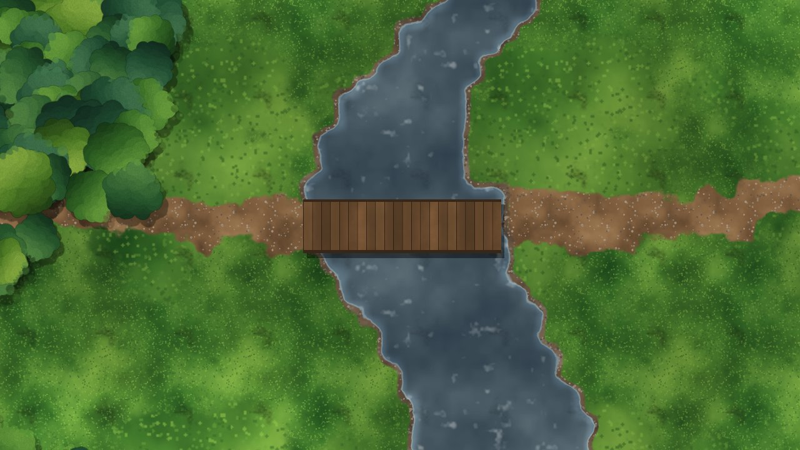
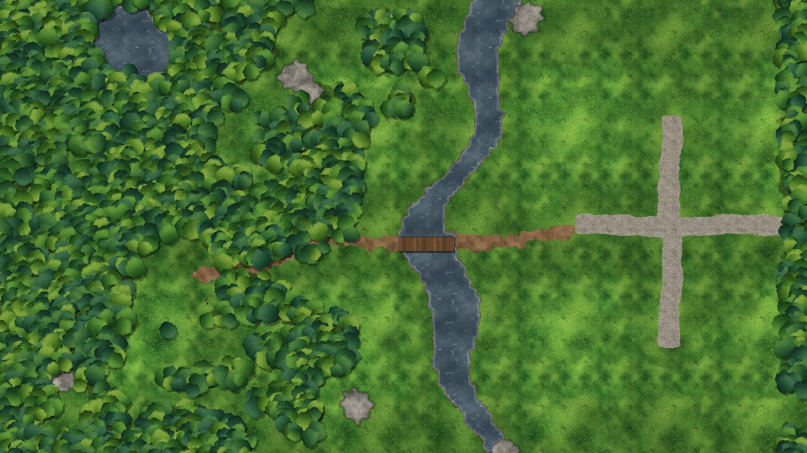
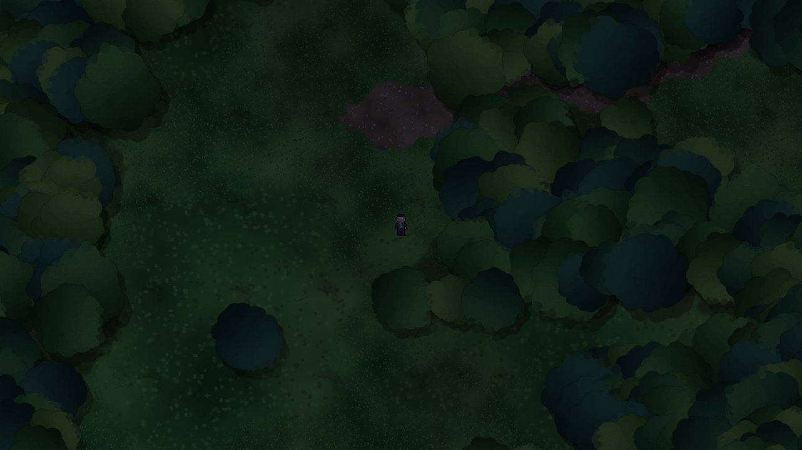

# Step 07b — World map and the 2D look

> **Replaced.** The shader-painted terrain in this step was replaced by the pre-rendered
> Blender forest and Godot TileMapLayer in [`docs/world/forest_world.md`](../world/forest_world.md).
> Do that instead. This page stays for reference: its fixes (waiting for the navigation map to
> answer a query, separate textures per sampler) still apply.

**Goal:** replace the test rectangle with the real starting world (forest,
campsite clearing, trail, river with a bridge, pond, rock outcrops, town
ground) drawn in a lush top-down style. You can then redesign the world by
**painting a small PNG**.

Do this step right after step 07.



## 7b.1 How it fits the architecture

| Piece | Layer | What it does |
|-------|-------|--------------|
| `world/map/terrain_map.png` | **World truth** (authored) | One pixel = one 2 m cell. The colour says what the ground is. |
| `SimTerrain` | Simulation | Reads the PNG. Answers "what is at this position?" and "is it walkable?" in metres. No 2D types. |
| `NavBuilder2D` | 2D adapter | Builds the navigation mesh: water and rock become obstacles; the bridge is walkable. |
| `TerrainView2D` + `terrain.gdshader` | View | Paints the ground as one shaded rectangle with blended textures and organic edges. No tile grid. |
| `TreeLayer2D` | View | Tree canopies over forest cells, placed from the world seed. They fade when the survivor walks underneath. |
| `DayNight2D` | View | Tints the world by time of day (the UI is not tinted). |
| `ObserverCamera2D` | View | Follows the survivor. WASD/arrows pan, F follows again, the mouse wheel zooms. |

When the 3D view comes later, `SimTerrain` and the map stay. Only the three
view scripts and the nav builder get 3D versions.

## 7b.2 Art and map files

All art is **original and procedural**, generated by two scripts now in the
repo:
- `tools/gen_art.py` makes tileable grass, water, dirt, bank, rock, gravel,
  plank and noise textures, plus 8 tree canopies.
- `tools/gen_starter_map.py` makes the starter map. It is run once; after that
  the PNG is the source and you edit it by hand.

The generated files are already committed, so you don't need to run the
scripts. Copy them into the Godot project:

| From (repo) | To (Godot project) |
|-------------|--------------------|
| `docs/phase0/assets/world/art/*.png` | `godot/views/view2d/art/` |
| `docs/phase0/assets/world/terrain_map.png` | `godot/world/map/terrain_map.png` |
| `docs/phase0/assets/survivor_portrait.png` | also copy to `godot/views/view2d/art/survivor.png` |

To regenerate or vary the art (needs `pip install numpy pillow`):
`python tools/gen_art.py --out godot/views/view2d/art --seed 7`. Change the
seed for different variations, or replace any PNG with hand-made art of the
same name. CC0 texture sites such as Poly Haven work well for that.

## 7b.3 Editing the world: the map legend

Open `terrain_map.png` in any image editor (Aseprite, Krita, GIMP, even
Paint). Use a **pencil with no anti-aliasing** and these exact colours. Near
misses snap to the closest colour.

| Terrain | RGB | Walkable |
|---------|-----|----------|
| Grass | 100, 170, 70 | yes |
| Forest (grass + trees) | 40, 110, 50 | yes |
| Water | 50, 100, 180 | **no** |
| Trail (dirt) | 160, 120, 70 | yes |
| Rock | 128, 128, 128 | **no** |
| Gravel (town streets) | 200, 200, 190 | yes |
| Bridge | 120, 70, 30 | yes |

The starter map is 160 × 120 pixels, which is 320 × 240 m. The campsite
clearing is centred on pixel (35, 70), which is (70, 140) m.



## 7b.4 Simulation: terrain truth and navigation

`godot/sim/terrain/sim_terrain.gd`
```gdscript
class_name SimTerrain
extends RefCounted
## WORLD TRUTH: what the ground is, per cell. Loaded from an editable PNG where
## one pixel = one cell and the colour says the terrain (see LEGEND).
## Dimension-agnostic: positions are sim metres; cells are (cx, cz) integer pairs.

enum T { GRASS, FOREST, WATER, TRAIL, ROCK, GRAVEL, BRIDGE }

## Paint the map with these colours. Near-misses snap to the closest entry.
const LEGEND := {
	T.GRASS: Color8(100, 170, 70),
	T.FOREST: Color8(40, 110, 50),
	T.WATER: Color8(50, 100, 180),
	T.TRAIL: Color8(160, 120, 70),
	T.ROCK: Color8(128, 128, 128),
	T.GRAVEL: Color8(200, 200, 190),
	T.BRIDGE: Color8(120, 70, 30),
}
const WALKABLE := {
	T.GRASS: true, T.FOREST: true, T.WATER: false, T.TRAIL: true,
	T.ROCK: false, T.GRAVEL: true, T.BRIDGE: true,
}

var cell_m: float = 2.0
var width: int = 0     # cells along x
var depth: int = 0     # cells along z
var _cells := PackedByteArray()


static func load_from(path: String, cell_size_m: float) -> SimTerrain:
	var tex := load(path) as Texture2D
	assert(tex != null, "terrain map not found: " + path)
	var img := tex.get_image()
	if img.is_compressed():
		img.decompress()
	var t := SimTerrain.new()
	t.cell_m = cell_size_m
	t.width = img.get_width()
	t.depth = img.get_height()
	t._cells.resize(t.width * t.depth)
	for cz in t.depth:
		for cx in t.width:
			t._cells[cz * t.width + cx] = _closest(img.get_pixel(cx, cz))
	return t


static func _closest(c: Color) -> int:
	var best := T.GRASS
	var best_d := INF
	for kind in LEGEND:
		var l: Color = LEGEND[kind]
		var d := (c.r - l.r) ** 2 + (c.g - l.g) ** 2 + (c.b - l.b) ** 2
		if d < best_d:
			best_d = d
			best = kind
	return best


## Out-of-bounds counts as ROCK: the world edge is impassable.
func at_cell(cx: int, cz: int) -> int:
	if cx < 0 or cz < 0 or cx >= width or cz >= depth:
		return T.ROCK
	return _cells[cz * width + cx]


func at(pos: Vector3) -> int:
	return at_cell(floori(pos.x / cell_m), floori(pos.z / cell_m))


func is_walkable_cell(cx: int, cz: int) -> bool:
	return WALKABLE[at_cell(cx, cz)]


func cell_center(cx: int, cz: int) -> Vector3:
	return Vector3((cx + 0.5) * cell_m, 0.0, (cz + 0.5) * cell_m)


func size_m() -> Vector3:
	return Vector3(width * cell_m, 0.0, depth * cell_m)
```

`godot/sim/spatial/nav_builder_2d.gd`
```gdscript
class_name NavBuilder2D
## Builds the 2D navigation mesh from SimTerrain: water and rock become obstacles.
## (A NavBuilder3D will do the same from the same SimTerrain later.)


static func build(terrain: SimTerrain, region: NavigationRegion2D, agent_radius_m: float = 0.3) -> void:
	var cell_px := terrain.cell_m * SimUnits.PIXELS_PER_METRE
	var poly := NavigationPolygon.new()
	poly.agent_radius = agent_radius_m * SimUnits.PIXELS_PER_METRE
	var src := NavigationMeshSourceGeometryData2D.new()
	var size := SimUnits.to_screen(terrain.size_m())
	src.add_traversable_outline(PackedVector2Array([
			Vector2.ZERO, Vector2(size.x, 0), size, Vector2(0, size.y)]))
	# One obstruction rectangle per horizontal run of blocked cells (keeps the count low).
	for cz in terrain.depth:
		var cx := 0
		while cx < terrain.width:
			if terrain.is_walkable_cell(cx, cz):
				cx += 1
				continue
			var start := cx
			while cx < terrain.width and not terrain.is_walkable_cell(cx, cz):
				cx += 1
			var x0 := start * cell_px
			var x1 := cx * cell_px
			var y0 := cz * cell_px
			var y1 := (cz + 1) * cell_px
			src.add_obstruction_outline(PackedVector2Array([
					Vector2(x0, y0), Vector2(x1, y0), Vector2(x1, y1), Vector2(x0, y1)]))
	NavigationServer2D.bake_from_source_geometry_data(poly, src)
	region.navigation_polygon = poly
```

Replace `autoload/spatial.gd`. It gains `terrain`:

`godot/autoload/spatial.gd`
```gdscript
extends Node
## Holds the active spatial implementations (2D now, 3D later) and the terrain truth.
## Simulation code calls Spatial.nav / Spatial.query / Spatial.terrain and never touches 2D APIs directly.

signal nav_ready

var nav: SimNavigation
var query: SimSpatialQuery
var terrain: SimTerrain


func install(new_nav: SimNavigation, new_query: SimSpatialQuery) -> void:
	nav = new_nav
	query = new_query
	nav_ready.emit()
```

## 7b.5 The world script

Replace the step 07 `world/world.gd`:

`godot/world/world.gd`
```gdscript
extends Node2D
## Loads the terrain truth, builds navigation from it, and dresses it with 2D views.

const MAP_PATH := "res://world/map/terrain_map.png"
const CELL_M := 2.0   # metres per map pixel

@onready var _nav_region: NavigationRegion2D = $NavigationRegion2D
@onready var _terrain_view: TerrainView2D = $TerrainView2D
@onready var _trees: TreeLayer2D = $TreeLayer2D


func _ready() -> void:
	var terrain := SimTerrain.load_from(MAP_PATH, CELL_M)
	Spatial.terrain = terrain
	NavBuilder2D.build(terrain, _nav_region)
	_terrain_view.show_terrain(terrain)
	_trees.populate(terrain, SaveManager.world_seed)
	# The navigation server syncs maps in the background; a big map can take many frames,
	# and the first sync may not include our region yet. So never wait a fixed number of
	# frames: wait until the map really answers a query at a spot we know is walkable.
	var map := get_world_2d().get_navigation_map()
	var probe := SimUnits.to_screen(_open_ground(terrain))
	var frames := 0
	while true:
		await get_tree().physics_frame
		frames += 1
		if NavigationServer2D.map_get_iteration_id(map) > 0 \
				and NavigationServer2D.map_get_closest_point(map, probe).distance_to(probe) < 1.0:
			break
	Spatial.install(SimNavigation2D.new(map), SimSpatialQuery.new())
	print("World: %dx%d m terrain, navigation ready after %d frames" % [terrain.size_m().x, terrain.size_m().z, frames])


## Centre of a cell whose whole neighbourhood is walkable (safe from the agent-radius margin).
static func _open_ground(terrain: SimTerrain) -> Vector3:
	for cz in range(1, terrain.depth - 1):
		for cx in range(1, terrain.width - 1):
			var open := true
			for dz in range(-1, 2):
				for dx in range(-1, 2):
					open = open and terrain.is_walkable_cell(cx + dx, cz + dz)
			if open:
				return terrain.cell_center(cx, cz)
	push_error("World: the terrain map has no open ground at all")
	return Vector3.ZERO
```

## 7b.6 View layer

`godot/views/view2d/terrain.gdshader`
```glsl
// Paints the terrain map with blended, tiling textures and organic, noisy edges.
// Inputs are per-cell weight maps built from SimTerrain (see terrain_view_2d.gd).
shader_type canvas_item;

uniform sampler2D weights_a : filter_linear, repeat_disable;       // r water  g trail  b rock  a gravel
uniform sampler2D weights_b : filter_linear, repeat_disable;       // r forest g bridge
uniform sampler2D weights_b_sharp : filter_nearest, repeat_disable; // same as weights_b, crisp (bridge)
uniform sampler2D tex_grass : filter_linear_mipmap, repeat_enable;
uniform sampler2D tex_water : filter_linear_mipmap, repeat_enable;
uniform sampler2D tex_dirt : filter_linear_mipmap, repeat_enable;
uniform sampler2D tex_bank : filter_linear_mipmap, repeat_enable;
uniform sampler2D tex_rock : filter_linear_mipmap, repeat_enable;
uniform sampler2D tex_gravel : filter_linear_mipmap, repeat_enable;
uniform sampler2D tex_planks : filter_linear_mipmap, repeat_enable;
uniform sampler2D tex_noise : filter_linear, repeat_enable;
uniform vec2 map_px;
uniform vec2 map_cells;
uniform float texture_px = 256.0;   // world pixels per texture repeat

float n(vec2 p) { return texture(tex_noise, p).r; }

void fragment() {
	vec2 px = UV * map_px;
	vec2 cell_uv = 1.0 / map_cells;
	vec2 warp = (vec2(n(px / 900.0), n(px / 900.0 + vec2(0.37, 0.71))) - 0.5) * cell_uv * 1.4;
	vec4 wa = texture(weights_a, UV + warp);
	vec4 wb = texture(weights_b, UV + warp);
	float fine = n(px / 140.0) - 0.5;
	float macro = n(px / 1400.0);
	vec2 tuv = px / texture_px;

	// Ground: grass, darker forest floor under the canopy.
	// Two samples at unrelated scales, blended by noise, hide the texture's repeat.
	vec3 grass_a = texture(tex_grass, tuv).rgb;
	vec3 grass_b = texture(tex_grass, tuv * 0.43 + vec2(0.31, 0.77)).rgb;
	vec3 grass = mix(grass_a, grass_b, smoothstep(0.35, 0.65, n(px / 650.0))) * (0.8 + 0.4 * macro);
	vec3 forest_floor = mix(grass * vec3(0.6, 0.7, 0.6), texture(tex_dirt, tuv * 1.3).rgb * 0.6, 0.25);
	vec3 col = mix(grass, forest_floor, smoothstep(0.35, 0.75, wb.r + fine * 1.1));

	col = mix(col, texture(tex_gravel, tuv * 1.5).rgb, smoothstep(0.42, 0.58, wa.a + fine * 0.4));
	col = mix(col, texture(tex_dirt, tuv * 1.2).rgb, smoothstep(0.40, 0.60, wa.g + fine * 0.8));

	// Water with a rocky-earth bank around it.
	float wv = wa.r + fine * 0.35;
	col = mix(col, texture(tex_bank, tuv * 1.5).rgb, smoothstep(0.18, 0.32, wv));
	float water = smoothstep(0.45, 0.52, wv);
	vec3 wcol = texture(tex_water, tuv * 0.8 + vec2(TIME * 0.004, TIME * 0.011)).rgb;
	wcol *= mix(1.05, 0.8, smoothstep(0.55, 1.0, wa.r));                 // deeper = darker
	wcol = mix(wcol, vec3(0.82, 0.86, 0.85), (1.0 - smoothstep(0.52, 0.6, wv)) * 0.35);  // shoreline foam
	col = mix(col, wcol, water);

	// Rock outcrops: a soft contact shadow, then the rock.
	float rv = wa.b + fine * 0.5;
	col *= 1.0 - 0.35 * smoothstep(0.12, 0.42, rv) * (1.0 - smoothstep(0.42, 0.5, rv));
	vec3 rcol = texture(tex_rock, tuv * 0.9).rgb * (0.9 + 0.3 * smoothstep(0.5, 1.0, rv));
	col = mix(col, rcol, smoothstep(0.42, 0.5, rv));

	// Bridge: crisp planks laid across the river (boards run north-south),
	// a dark rail along each long edge, and a shadow cast onto the water.
	vec2 one_px = 1.0 / map_px;
	float bridge = texture(weights_b_sharp, UV).g;
	float shadow = texture(weights_b_sharp, UV - one_px * vec2(6.0, 9.0)).g * (1.0 - bridge);
	col *= 1.0 - 0.45 * shadow;
	float rail = bridge * (1.0 - texture(weights_b_sharp, UV + one_px * vec2(0.0, 5.0)).g
			* texture(weights_b_sharp, UV - one_px * vec2(0.0, 5.0)).g);
	vec3 planks = texture(tex_planks, vec2(px.y, px.x) / 128.0).rgb;
	planks = mix(planks, vec3(0.22, 0.15, 0.1), rail);
	col = mix(col, planks, bridge);

	COLOR = vec4(col, 1.0);
}
```

`godot/views/view2d/terrain_view_2d.gd`
```gdscript
class_name TerrainView2D
extends Node2D
## Cosmetic: draws SimTerrain as one shaded rectangle (no visible tile grid).
## Views may read world truth: that is what the observer sees.

const ART := "res://views/view2d/art/"
const SHADER := "res://views/view2d/terrain.gdshader"


func show_terrain(terrain: SimTerrain) -> void:
	var wa := Image.create(terrain.width, terrain.depth, false, Image.FORMAT_RGBA8)
	var wb := Image.create(terrain.width, terrain.depth, false, Image.FORMAT_RGBA8)
	for cz in terrain.depth:
		for cx in terrain.width:
			var t := terrain.at_cell(cx, cz)
			var water := 1.0 if t == SimTerrain.T.WATER or t == SimTerrain.T.BRIDGE else 0.0
			wa.set_pixel(cx, cz, Color(water, float(t == SimTerrain.T.TRAIL),
					float(t == SimTerrain.T.ROCK), float(t == SimTerrain.T.GRAVEL)))
			wb.set_pixel(cx, cz, Color(float(t == SimTerrain.T.FOREST), float(t == SimTerrain.T.BRIDGE), 0, 1))
	var mat := ShaderMaterial.new()
	mat.shader = load(SHADER)
	mat.set_shader_parameter("weights_a", ImageTexture.create_from_image(wa))
	mat.set_shader_parameter("weights_b", ImageTexture.create_from_image(wb))
	# A SEPARATE texture for the crisp copy: on the Compatibility renderer the filter
	# belongs to the texture object, so sharing one would make both samplers nearest.
	mat.set_shader_parameter("weights_b_sharp", ImageTexture.create_from_image(wb))
	for name in ["grass", "water", "dirt", "bank", "rock", "gravel", "planks", "noise"]:
		mat.set_shader_parameter("tex_" + name, load(ART + name + ".png"))
	var size_px := SimUnits.to_screen(terrain.size_m())
	mat.set_shader_parameter("map_px", size_px)
	mat.set_shader_parameter("map_cells", Vector2(terrain.width, terrain.depth))
	var rect := ColorRect.new()
	rect.size = size_px
	rect.material = mat
	rect.mouse_filter = Control.MOUSE_FILTER_IGNORE
	add_child(rect)
```

`godot/views/view2d/tree_layer_2d.gd`
```gdscript
class_name TreeLayer2D
extends Node2D
## Cosmetic tree canopies over FOREST cells, placed deterministically from the world seed.
## Canopies fade when an agent walks underneath. (In Phase 2 trees become real resource
## entities that can be chopped; this layer will then draw those instead.)

const DENSITY := 0.42           # chance of a tree per forest cell
const FADE_RADIUS_M := 3.5
const FADED_ALPHA := 0.35
const BUCKET_CELLS := 4

var _buckets: Dictionary = {}   # Vector2i -> Array of canopy sprites
var _faded: Array = []
var _cell_m := 2.0
var _timer := 0.0


func populate(terrain: SimTerrain, world_seed: int) -> void:
	_cell_m = terrain.cell_m
	var rng := RandomNumberGenerator.new()
	rng.seed = world_seed
	var textures := []
	for i in 4:
		for v in 2:
			textures.append(load("res://views/view2d/art/tree_%d_%d.png" % [i, v]))
	var shadows := Node2D.new()
	shadows.z_index = 1            # above the ground, below agents (z 2)
	add_child(shadows)
	var canopies := Node2D.new()
	canopies.z_index = 3           # above agents
	add_child(canopies)
	for cz in terrain.depth:
		for cx in terrain.width:
			if terrain.at_cell(cx, cz) != SimTerrain.T.FOREST or rng.randf() > DENSITY:
				continue
			var pos := terrain.cell_center(cx, cz) + Vector3(rng.randf_range(-0.8, 0.8), 0, rng.randf_range(-0.8, 0.8))
			var tree := Sprite2D.new()
			tree.texture = textures[rng.randi() % textures.size()]
			tree.position = SimUnits.to_screen(pos)
			tree.rotation = rng.randf() * TAU
			tree.scale = Vector2.ONE * rng.randf_range(0.75, 1.25)
			var shadow := Sprite2D.new()
			shadow.texture = tree.texture
			shadow.position = tree.position + Vector2(10, 14) * tree.scale.x
			shadow.rotation = tree.rotation
			shadow.scale = tree.scale
			shadow.modulate = Color(0, 0, 0, 0.35)
			shadows.add_child(shadow)
			canopies.add_child(tree)
			var key := Vector2i(cx / BUCKET_CELLS, cz / BUCKET_CELLS)
			if not _buckets.has(key):
				_buckets[key] = []
			_buckets[key].append(tree)


func _process(delta: float) -> void:
	_timer -= delta
	if _timer > 0.0:
		return
	_timer = 0.1
	for tree in _faded:
		tree.modulate.a = 1.0
	_faded.clear()
	var radius_px := FADE_RADIUS_M * SimUnits.PIXELS_PER_METRE
	for e in WorldRegistry.all():
		if not e is AgentBody:
			continue
		var p := SimUnits.to_screen(e.sim_position)
		var key := Vector2i(floori(e.sim_position.x / _cell_m) / BUCKET_CELLS,
				floori(e.sim_position.z / _cell_m) / BUCKET_CELLS)
		for dx in range(-1, 2):
			for dz in range(-1, 2):
				for tree in _buckets.get(key + Vector2i(dx, dz), []):
					if tree.position.distance_to(p) < radius_px + 40.0 * tree.scale.x:
						tree.modulate.a = FADED_ALPHA
						_faded.append(tree)
```

`godot/views/view2d/day_night_2d.gd`
```gdscript
class_name DayNight2D
extends CanvasModulate
## Tints the world by time of day. UI on CanvasLayers is not affected.

const KEYS := [   # [minute of day, tint]
	[0, Color(0.22, 0.26, 0.42)],
	[300, Color(0.28, 0.31, 0.47)],
	[390, Color(0.95, 0.74, 0.64)],
	[480, Color(1, 1, 1)],
	[1080, Color(1, 0.97, 0.92)],
	[1170, Color(0.95, 0.68, 0.56)],
	[1260, Color(0.3, 0.32, 0.5)],
	[1440, Color(0.22, 0.26, 0.42)],
]


func _process(_delta: float) -> void:
	var m := float(SimClock.tick % SimClock.MINUTES_PER_DAY)
	for i in KEYS.size() - 1:
		var a: Array = KEYS[i]
		var b: Array = KEYS[i + 1]
		if m >= a[0] and m <= b[0]:
			color = (a[1] as Color).lerp(b[1], (m - a[0]) / float(b[0] - a[0]))
			return
```

`godot/views/view2d/observer_camera_2d.gd`
```gdscript
class_name ObserverCamera2D
extends Camera2D
## The player's eye. Follows the survivor by default.
## WASD / arrows: pan (stops following).  F: follow again.  Mouse wheel: zoom.

@export var follow_agent_id: String = "a_0001"
@export var pan_speed_px: float = 900.0
@export var min_zoom: float = 0.15
@export var max_zoom: float = 2.5

var following := true
var _agent: AgentBody


func _ready() -> void:
	zoom = Vector2(0.8, 0.8)
	position_smoothing_enabled = true
	Spatial.nav_ready.connect(_apply_limits)


func _apply_limits() -> void:
	var size := SimUnits.to_screen(Spatial.terrain.size_m())
	limit_left = 0
	limit_top = 0
	limit_right = int(size.x)
	limit_bottom = int(size.y)


func _process(delta: float) -> void:
	var dir := Vector2(
			float(Input.is_key_pressed(KEY_D) or Input.is_key_pressed(KEY_RIGHT))
			- float(Input.is_key_pressed(KEY_A) or Input.is_key_pressed(KEY_LEFT)),
			float(Input.is_key_pressed(KEY_S) or Input.is_key_pressed(KEY_DOWN))
			- float(Input.is_key_pressed(KEY_W) or Input.is_key_pressed(KEY_UP)))
	if dir != Vector2.ZERO:
		following = false
		position += dir.normalized() * pan_speed_px * delta / zoom.x
	elif following:
		if _agent == null:
			for e in WorldRegistry.all():
				if e is AgentBody and e.agent_id == follow_agent_id:
					_agent = e
		if _agent != null:
			position = SimUnits.to_screen(_agent.sim_position)


func _unhandled_input(event: InputEvent) -> void:
	var mb := event as InputEventMouseButton
	if mb and mb.pressed:
		if mb.button_index == MOUSE_BUTTON_WHEEL_UP:
			zoom = (zoom * 1.12).clamp(Vector2.ONE * min_zoom, Vector2.ONE * max_zoom)
		elif mb.button_index == MOUSE_BUTTON_WHEEL_DOWN:
			zoom = (zoom / 1.12).clamp(Vector2.ONE * min_zoom, Vector2.ONE * max_zoom)
	var key := event as InputEventKey
	if key and key.pressed and not key.echo and key.keycode == KEY_F:
		following = true
```

## 7b.7 Scene changes

**`world/world.tscn`.** Rebuild it. The order matters for drawing:
```
World (Node2D)                 script: world.gd
├── TerrainView2D (Node2D)     script: views/view2d/terrain_view_2d.gd
├── NavigationRegion2D         leave its navigation polygon EMPTY (built from the map)
├── Agents (Node2D)
│   └── AgentBody (instance)   right-click → Editable Children → set View2D position to (1120, 2240)
├── TreeLayer2D (Node2D)       script: views/view2d/tree_layer_2d.gd
└── DayNight2D (CanvasModulate) script: views/view2d/day_night_2d.gd
```
(1120, 2240) px is the campsite centre, (70, 140) m, at 16 px per metre.

**`entities/agent/agent_body.tscn`.** Set `View2D` → **Z Index 2**, so the
survivor draws above tree shadows and below canopies. On its `Sprite2D`, set
the texture to `views/view2d/art/survivor.png`, scale **1.5**, and Texture →
Filter **Nearest**.

**`scenes/main.tscn`.** Replace `Camera2D` with a Camera2D named
`ObserverCamera2D` that has `observer_camera_2d.gd` attached.

**Drawing order (z-index):** ground 0 · tree shadows 1 · survivor 2 ·
canopies 3.

## Check it works

1. Run. The output shows
   `World: 320x240 m terrain, navigation ready after N frames` (N is usually
   10–20). The camera follows the survivor in the campsite clearing at 06:00,
   with warm dawn light.
2. **Look around:** WASD to pan to the river; the water moves gently. Find the
   bridge east of camp and the town's gravel streets past it. Mouse-wheel all
   the way out for the whole map. Press **F** to snap back to the survivor.
3. **Navigation respects the terrain.** With the `DevClickToWalk` tool from
   step 07 (it stays until step 10), click across the river. The survivor walks
   to the bridge, crosses, and comes back down the other bank. Click in the
   pond: they stop at the shore.
4. **Canopy fade:** when the survivor walks under trees, the nearby canopies
   turn see-through.
5. **Edit the world:** paint a new pond in `terrain_map.png`, save, run. It
   appears, and the survivor walks around it.
6. Press `=` to speed up time and watch dusk and night arrive.
7. **3D-readiness:** `Vector2` in `sim/` appears only in `sim_units.gd`,
   `sim_navigation_2d.gd` and `nav_builder_2d.gd`, the three 2D adapters.





## What was verified, and three bugs it caught

This step was run headless and under a virtual display on Godot 4.6.
Pathfinding was tested on the real map: campsite → town crosses the bridge and
never touches water or rock; a crossing far from the bridge detours 165 m
through it; a target in the pond stops at the shore. Three bugs were found and
fixed:

1. **Navigation queries came back empty.** On a real-size map the navigation
   server needs ~12–20 frames to sync, and the first sync may not include the
   region yet. `world.gd` now waits until the map answers a query (this also
   fixed step 07).
2. **Square dark patches in the forest floor.** The same texture was bound to
   a smooth sampler and a sharp one. On the Compatibility renderer the filter
   belongs to the texture, so both became sharp. Now there are two separate
   textures.
3. **The bridge had a one-cell step.** The map generator now makes it one
   clean rectangle.

## Common mistakes

- **Painting with an anti-aliased brush.** Edges get in-between colours, which
  snap to random terrain types. Use a pencil tool.
- **Saving the map as JPG.** Compression shifts colours. Always use PNG.
- **Putting a tree directly on the trail.** Trees only grow on forest cells.
  Paint trail cells to clear them.
- **Putting walkability in the view** (e.g. "is there a tree sprite here?").
  Walkability comes only from `SimTerrain`, which is truth. The views just
  draw it.
