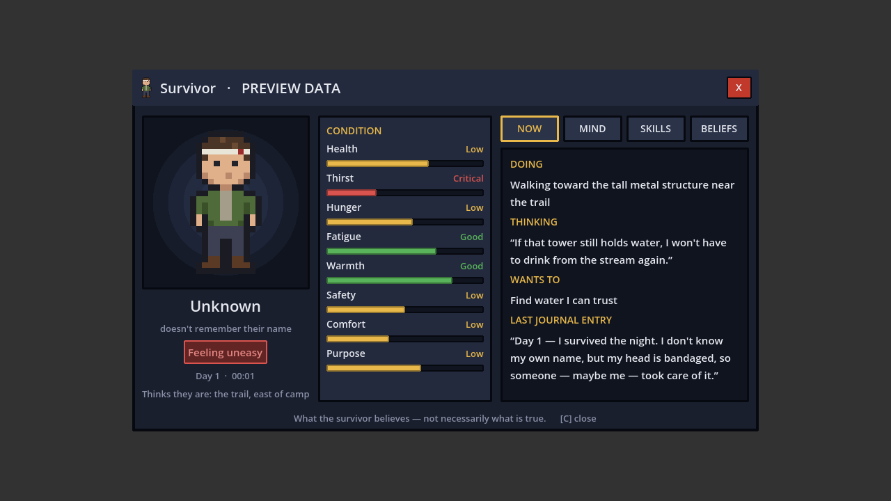
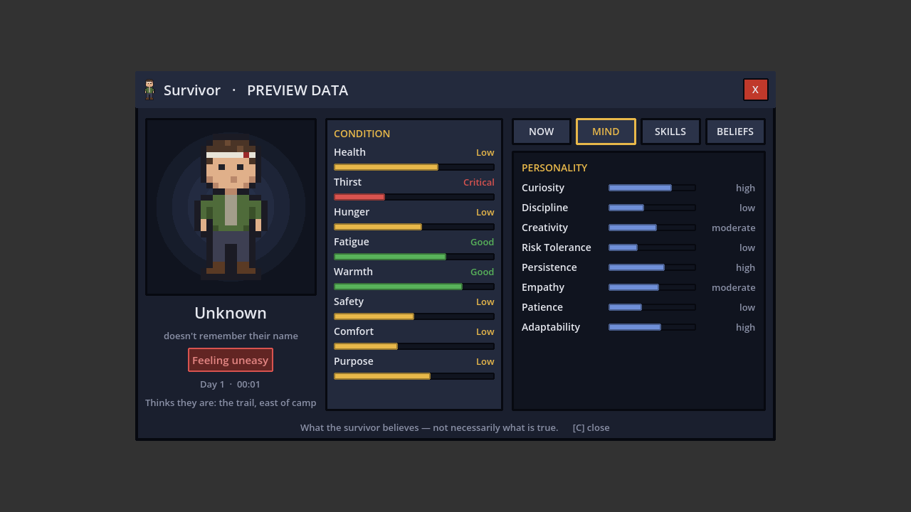
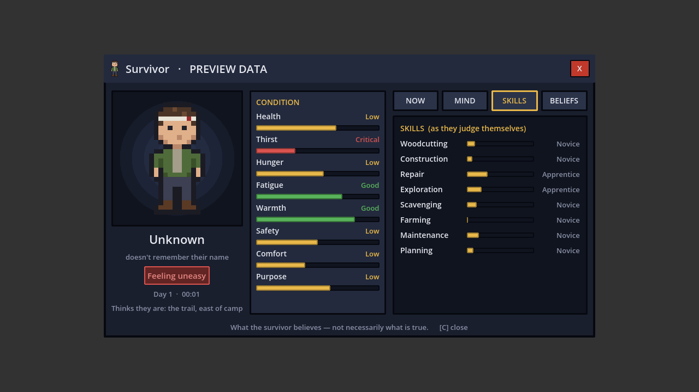
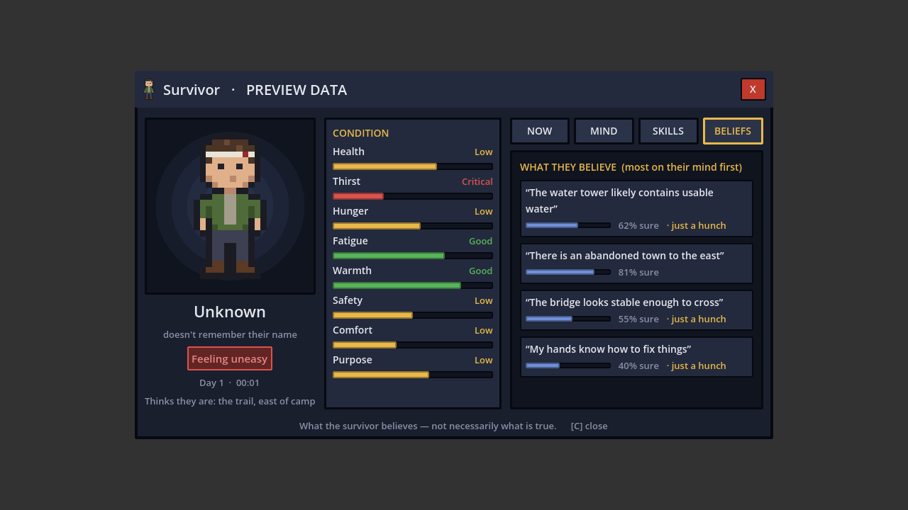
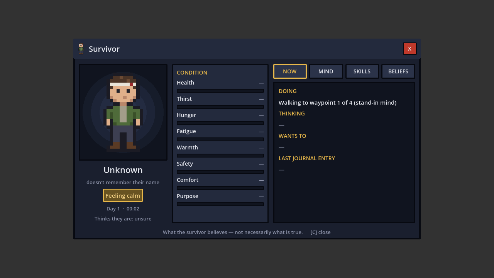

# Step 14 — Character panel

**Goal:** a brief, pixel-styled card you open with **C** that shows what the
survivor's mind reports about itself: condition, mood, what they are doing and
thinking, personality, self-judged skills, and their beliefs.



## 15.1 The rule this panel follows

The panel shows the **mind's view**, never world truth. Needs are *perceived*,
skills are *self-assessed*, and beliefs *may be wrong*. The footer says so.
(Truth vs belief comparison is a separate developer tool in Phase 1.)

Its data comes only from `mind_telemetry` messages (step 04). Until the real
mind arrives in Phase 1, the stand-in mind honestly reports only its activity,
and everything else shows "—".

| Tab | Shows |
|-----|-------|
| **NOW** | What they're doing, their current thought, what they want, their last journal entry |
| **MIND** | The 8 personality traits |
| **SKILLS** | The 8 skills *as they judge themselves*: Novice → Expert |
| **BELIEFS** | The top 6 beliefs, how sure they are, and whether it's "just a hunch" |

The left side always shows the portrait, the name ("Unknown" until they learn
or choose one), mood, day and time, and where they *think* they are. The
middle column shows their condition, with each need as Good, Low, or Critical.

## 15.2 Files

1. Copy `docs/phase0/assets/survivor_portrait.png` to
   `godot/ui/character_panel/survivor_portrait.png`. It is an original 16×24
   placeholder. In its Import tab, keep **Filter: Nearest** (the panel also
   forces nearest filtering).
2. Create the script:

`godot/ui/character_panel/character_panel.gd`
```gdscript
class_name CharacterPanel
extends CanvasLayer
## Observer UI: a brief card showing what the survivor's MIND reports about itself.
## Everything shown is subjective (perceived needs, self-assessed skills, beliefs that
## may be wrong). Data arrives as `mind_telemetry` messages. Never feeds world logic.
## Toggle with C. Run with `-- --panel-preview` to see it filled with sample data.

const FONT_PATH := "res://ui/fonts/pixel_font.ttf"   # optional: drop any pixel font here
const PORTRAIT_PATH := "res://ui/character_panel/survivor_portrait.png"

const COL_SCREEN_DIM := Color(0, 0, 0, 0.35)
const COL_BG := Color("1a1f2e")
const COL_HEADER := Color("232a3d")
const COL_INSET := Color("10141f")
const COL_TILE := Color("2b3349")
const COL_BORDER := Color("070910")
const COL_ACCENT := Color("e8b84a")
const COL_TEXT := Color("e6e8ef")
const COL_DIM := Color("8a90a6")
const COL_GOOD := Color("58b35a")
const COL_WARN := Color("e8b84a")
const COL_BAD := Color("d9534f")
const COL_CLOSE := Color("c0392b")

const NEEDS := ["health", "thirst", "hunger", "fatigue", "warmth", "safety", "comfort", "purpose"]
const TRAITS := ["curiosity", "discipline", "creativity", "risk_tolerance",
		"persistence", "empathy", "patience", "adaptability"]
const SKILLS := ["woodcutting", "construction", "repair", "exploration",
		"scavenging", "farming", "maintenance", "planning"]
const TABS := ["now", "mind", "skills", "beliefs"]

@export var agent_id: String = "a_0001"
@export var start_open: bool = false

var _data: Dictionary = {}
var _preview := false
var _tab := "now"

var _name_label: Label
var _name_sub: Label
var _mood_chip: PanelContainer
var _mood_label: Label
var _time_label: Label
var _place_label: Label
var _need_bars: Dictionary = {}       # need -> [ProgressBar, Label]
var _tab_buttons: Dictionary = {}     # tab -> Button
var _content: VBoxContainer
var _header_title: Label


func _ready() -> void:
	layer = 10
	_preview = CmdArgs.all().has("panel-preview")
	if _preview:
		_data = _sample_data()
	_build()
	visible = start_open or _preview
	MindBridge.message.connect(_on_message)
	SimClock.ticked.connect(func(_t): if visible: _refresh_clock())
	_refresh()


func _unhandled_input(event: InputEvent) -> void:
	var key := event as InputEventKey
	if key and key.pressed and not key.echo and key.keycode == KEY_C:
		visible = not visible
		if visible:
			_refresh()


func _on_message(env: Dictionary) -> void:
	if env.get("type") != "mind_telemetry" or env.get("agent_id") != agent_id:
		return
	_preview = false
	_data = env.get("payload", {})
	if visible:
		_refresh()


# ---------------------------------------------------------------- building

func _build() -> void:
	var root := Control.new()
	root.set_anchors_preset(Control.PRESET_FULL_RECT)
	root.mouse_filter = Control.MOUSE_FILTER_IGNORE
	root.theme = _make_theme()
	add_child(root)

	var dim := ColorRect.new()
	dim.color = COL_SCREEN_DIM
	dim.set_anchors_preset(Control.PRESET_FULL_RECT)
	dim.mouse_filter = Control.MOUSE_FILTER_IGNORE
	root.add_child(dim)

	var center := CenterContainer.new()
	center.set_anchors_preset(Control.PRESET_FULL_RECT)
	center.mouse_filter = Control.MOUSE_FILTER_IGNORE
	root.add_child(center)

	var window := PanelContainer.new()
	window.custom_minimum_size = Vector2(900, 520)
	window.add_theme_stylebox_override("panel", _box(COL_BG, COL_BORDER, 4, 0))
	center.add_child(window)

	var outer := VBoxContainer.new()
	outer.add_theme_constant_override("separation", 0)
	window.add_child(outer)
	outer.add_child(_build_header())

	var body := HBoxContainer.new()
	body.add_theme_constant_override("separation", 12)
	body.size_flags_vertical = Control.SIZE_EXPAND_FILL
	var pad := MarginContainer.new()
	for side in ["left", "right", "top", "bottom"]:
		pad.add_theme_constant_override("margin_" + side, 14)
	pad.size_flags_vertical = Control.SIZE_EXPAND_FILL
	pad.add_child(body)
	outer.add_child(pad)

	body.add_child(_build_identity_column())
	body.add_child(_build_condition_column())
	body.add_child(_build_tabs_column())

	var footer := Label.new()
	footer.text = "What the survivor believes — not necessarily what is true.      [C] close"
	footer.add_theme_color_override("font_color", COL_DIM)
	footer.add_theme_font_size_override("font_size", 13)
	footer.horizontal_alignment = HORIZONTAL_ALIGNMENT_CENTER
	var fpad := MarginContainer.new()
	fpad.add_theme_constant_override("margin_bottom", 10)
	fpad.add_child(footer)
	outer.add_child(fpad)


func _build_header() -> Control:
	var bar := PanelContainer.new()
	bar.add_theme_stylebox_override("panel", _box(COL_HEADER, COL_BORDER, 0, 10))
	var row := HBoxContainer.new()
	row.add_theme_constant_override("separation", 10)
	bar.add_child(row)

	var icon := TextureRect.new()
	icon.texture = _portrait_texture()
	icon.texture_filter = CanvasItem.TEXTURE_FILTER_NEAREST
	icon.custom_minimum_size = Vector2(20, 30)
	icon.expand_mode = TextureRect.EXPAND_IGNORE_SIZE
	icon.stretch_mode = TextureRect.STRETCH_KEEP_ASPECT_CENTERED
	row.add_child(icon)

	_header_title = Label.new()
	_header_title.add_theme_font_size_override("font_size", 20)
	row.add_child(_header_title)

	var spacer := Control.new()
	spacer.size_flags_horizontal = Control.SIZE_EXPAND_FILL
	row.add_child(spacer)

	var close := Button.new()
	close.text = "X"
	close.custom_minimum_size = Vector2(36, 32)
	close.focus_mode = Control.FOCUS_NONE
	close.add_theme_stylebox_override("normal", _box(COL_CLOSE, COL_BORDER, 2, 4))
	close.add_theme_stylebox_override("hover", _box(COL_CLOSE.lightened(0.15), COL_BORDER, 2, 4))
	close.add_theme_stylebox_override("pressed", _box(COL_CLOSE.darkened(0.2), COL_BORDER, 2, 4))
	close.pressed.connect(func(): visible = false)
	row.add_child(close)
	return bar


func _build_identity_column() -> Control:
	var col := VBoxContainer.new()
	col.custom_minimum_size = Vector2(230, 0)
	col.add_theme_constant_override("separation", 8)

	var frame := PanelContainer.new()
	frame.add_theme_stylebox_override("panel", _box(COL_INSET, COL_BORDER, 3, 0))
	frame.custom_minimum_size = Vector2(230, 250)
	col.add_child(frame)

	var glow := Control.new()      # soft circular backdrop behind the portrait
	glow.draw.connect(func():
		var c := glow.size / 2.0
		for i in 4:
			glow.draw_circle(c, 105.0 - i * 22.0, Color(0.16, 0.2, 0.3, 0.25 + i * 0.12)))
	frame.add_child(glow)

	var portrait_pad := MarginContainer.new()
	for side in ["left", "right", "top", "bottom"]:
		portrait_pad.add_theme_constant_override("margin_" + side, 22)
	frame.add_child(portrait_pad)
	var portrait := TextureRect.new()
	portrait.texture = _portrait_texture()
	portrait.texture_filter = CanvasItem.TEXTURE_FILTER_NEAREST
	portrait.expand_mode = TextureRect.EXPAND_IGNORE_SIZE
	portrait.stretch_mode = TextureRect.STRETCH_KEEP_ASPECT_CENTERED
	portrait_pad.add_child(portrait)

	_name_label = Label.new()
	_name_label.add_theme_font_size_override("font_size", 22)
	_name_label.horizontal_alignment = HORIZONTAL_ALIGNMENT_CENTER
	col.add_child(_name_label)

	_name_sub = Label.new()
	_name_sub.add_theme_color_override("font_color", COL_DIM)
	_name_sub.add_theme_font_size_override("font_size", 13)
	_name_sub.horizontal_alignment = HORIZONTAL_ALIGNMENT_CENTER
	col.add_child(_name_sub)

	_mood_chip = PanelContainer.new()
	_mood_chip.size_flags_horizontal = Control.SIZE_SHRINK_CENTER
	_mood_label = Label.new()
	_mood_chip.add_child(_mood_label)
	col.add_child(_mood_chip)

	_time_label = _dim_label()
	_time_label.horizontal_alignment = HORIZONTAL_ALIGNMENT_CENTER
	col.add_child(_time_label)
	_place_label = _dim_label()
	_place_label.horizontal_alignment = HORIZONTAL_ALIGNMENT_CENTER
	col.add_child(_place_label)
	return col


func _build_condition_column() -> Control:
	var panel := PanelContainer.new()
	panel.add_theme_stylebox_override("panel", _box(COL_HEADER, COL_BORDER, 3, 12))
	panel.custom_minimum_size = Vector2(250, 0)
	var col := VBoxContainer.new()
	col.add_theme_constant_override("separation", 6)
	panel.add_child(col)
	col.add_child(_section_title("CONDITION"))
	for need in NEEDS:
		var name_row := HBoxContainer.new()
		var l := Label.new()
		l.text = need.capitalize()
		l.size_flags_horizontal = Control.SIZE_EXPAND_FILL
		l.add_theme_font_size_override("font_size", 14)
		var word := Label.new()
		word.add_theme_font_size_override("font_size", 13)
		name_row.add_child(l)
		name_row.add_child(word)
		col.add_child(name_row)
		var bar := _bar()
		col.add_child(bar)
		_need_bars[need] = [bar, word]
	return panel


func _build_tabs_column() -> Control:
	var col := VBoxContainer.new()
	col.size_flags_horizontal = Control.SIZE_EXPAND_FILL
	col.add_theme_constant_override("separation", 8)
	var tabs := HBoxContainer.new()
	tabs.add_theme_constant_override("separation", 6)
	col.add_child(tabs)
	for tab in TABS:
		var b := Button.new()
		b.text = tab.to_upper()
		b.focus_mode = Control.FOCUS_NONE
		b.size_flags_horizontal = Control.SIZE_EXPAND_FILL
		b.custom_minimum_size = Vector2(0, 38)
		b.pressed.connect(func(): _tab = tab; _refresh())
		tabs.add_child(b)
		_tab_buttons[tab] = b

	var inset := PanelContainer.new()
	inset.add_theme_stylebox_override("panel", _box(COL_INSET, COL_BORDER, 3, 14))
	inset.size_flags_vertical = Control.SIZE_EXPAND_FILL
	col.add_child(inset)
	var scroll := ScrollContainer.new()
	scroll.horizontal_scroll_mode = ScrollContainer.SCROLL_MODE_DISABLED
	inset.add_child(scroll)
	_content = VBoxContainer.new()
	_content.size_flags_horizontal = Control.SIZE_EXPAND_FILL
	_content.add_theme_constant_override("separation", 8)
	scroll.add_child(_content)
	return col


# ---------------------------------------------------------------- refreshing

func _refresh() -> void:
	var self_name = _data.get("self_name")
	_header_title.text = "Survivor" + ("   ·   PREVIEW DATA" if _preview else "")
	if self_name == null or str(self_name) == "":
		_name_label.text = "Unknown"
		_name_sub.text = "doesn't remember their name"
	else:
		_name_label.text = str(self_name)
		_name_sub.text = "the name they go by"

	var valence := float(_data.get("mood_valence", 0.0))
	var mood_col := COL_GOOD if valence > 0.2 else (COL_BAD if valence < -0.2 else COL_WARN)
	_mood_chip.add_theme_stylebox_override("panel", _box(mood_col.darkened(0.55), mood_col, 2, 6))
	_mood_label.text = "Feeling " + str(_data.get("mood", "—"))
	_mood_label.add_theme_color_override("font_color", mood_col.lightened(0.3))

	var place = _data.get("believed_place")
	_place_label.text = "Thinks they are: " + (str(place) if place else "unsure")
	_refresh_clock()

	var needs: Dictionary = _data.get("needs", {})
	for need in NEEDS:
		var bar: ProgressBar = _need_bars[need][0]
		var word: Label = _need_bars[need][1]
		if not needs.has(need):
			bar.value = 0
			word.text = "—"
			word.add_theme_color_override("font_color", COL_DIM)
			continue
		var level := 1.0 - clampf(float(needs[need]), 0.0, 1.0)   # deficit -> how OK it is
		bar.value = level
		var c := _level_color(level)
		_style_bar(bar, c)
		word.text = "Good" if level >= 0.7 else ("Low" if level >= 0.4 else "Critical")
		word.add_theme_color_override("font_color", c)

	for tab in TABS:
		var selected: bool = tab == _tab
		var b: Button = _tab_buttons[tab]
		var style := _box(COL_TILE, COL_ACCENT if selected else COL_BORDER, 3, 6)
		b.add_theme_stylebox_override("normal", style)
		b.add_theme_stylebox_override("hover", _box(COL_TILE.lightened(0.08), COL_ACCENT if selected else COL_DIM, 3, 6))
		b.add_theme_stylebox_override("pressed", style)
		b.add_theme_color_override("font_color", COL_ACCENT if selected else COL_TEXT)
		b.add_theme_color_override("font_hover_color", COL_ACCENT if selected else COL_TEXT)

	for child in _content.get_children():
		child.queue_free()
	match _tab:
		"now": _fill_now()
		"mind": _fill_scores("PERSONALITY", TRAITS, _data.get("traits", {}), false)
		"skills": _fill_scores("SKILLS  (as they judge themselves)", SKILLS, _data.get("skills", {}), true)
		"beliefs": _fill_beliefs()


func _refresh_clock() -> void:
	var minute_of_day := SimClock.tick % SimClock.MINUTES_PER_DAY
	_time_label.text = "Day %d  ·  %02d:%02d" % [SimClock.day() + 1, minute_of_day / 60, minute_of_day % 60]


func _fill_now() -> void:
	_add_field("DOING", _data.get("activity", ""), false)
	_add_field("THINKING", _data.get("thought"), true)
	_add_field("WANTS TO", _data.get("goal"), false)
	_add_field("LAST JOURNAL ENTRY", _data.get("last_journal"), true)


func _fill_scores(title: String, keys: Array, values: Dictionary, as_rank: bool) -> void:
	_content.add_child(_section_title(title))
	if values.is_empty():
		_content.add_child(_empty_note())
		return
	for key in keys:
		var row := HBoxContainer.new()
		var l := Label.new()
		l.text = str(key).capitalize()
		l.custom_minimum_size = Vector2(118, 0)
		l.add_theme_font_size_override("font_size", 14)
		row.add_child(l)
		var v := clampf(float(values.get(key, 0.0)), 0.0, 1.0)
		var bar := _bar()
		bar.size_flags_horizontal = Control.SIZE_EXPAND_FILL
		bar.size_flags_vertical = Control.SIZE_SHRINK_CENTER
		bar.value = v
		_style_bar(bar, COL_ACCENT if as_rank else Color("6f8fd8"))
		row.add_child(bar)
		var tail := Label.new()
		tail.custom_minimum_size = Vector2(80, 0)
		tail.horizontal_alignment = HORIZONTAL_ALIGNMENT_RIGHT
		tail.add_theme_font_size_override("font_size", 13)
		tail.add_theme_color_override("font_color", COL_DIM)
		tail.text = _rank(v) if as_rank else _trait_word(v)
		row.add_child(tail)
		_content.add_child(row)


func _fill_beliefs() -> void:
	_content.add_child(_section_title("WHAT THEY BELIEVE  (most on their mind first)"))
	var beliefs: Array = _data.get("beliefs", [])
	if beliefs.is_empty():
		_content.add_child(_empty_note())
		return
	for b in beliefs.slice(0, 6):
		var card := PanelContainer.new()
		card.add_theme_stylebox_override("panel", _box(COL_HEADER, COL_BORDER, 2, 8))
		var v := VBoxContainer.new()
		card.add_child(v)
		var text := Label.new()
		text.text = "“%s”" % str(b.get("text", ""))
		text.autowrap_mode = TextServer.AUTOWRAP_WORD_SMART
		text.add_theme_font_size_override("font_size", 14)
		v.add_child(text)
		var row := HBoxContainer.new()
		var conf := clampf(float(b.get("confidence", 0.0)), 0.0, 1.0)
		var bar := _bar()
		bar.custom_minimum_size = Vector2(120, 8)
		bar.size_flags_vertical = Control.SIZE_SHRINK_CENTER
		bar.value = conf
		_style_bar(bar, Color("6f8fd8"))
		row.add_child(bar)
		var label := _dim_label()
		label.text = "  %d%% sure" % roundi(conf * 100.0)
		row.add_child(label)
		if b.get("hypothesis", false):
			var tag := Label.new()
			tag.text = "  · just a hunch"
			tag.add_theme_font_size_override("font_size", 13)
			tag.add_theme_color_override("font_color", COL_WARN)
			row.add_child(tag)
		v.add_child(row)
		_content.add_child(card)


# ---------------------------------------------------------------- helpers

func _add_field(title: String, value, quoted: bool) -> void:
	_content.add_child(_section_title(title))
	var l := Label.new()
	l.autowrap_mode = TextServer.AUTOWRAP_WORD_SMART
	l.add_theme_font_size_override("font_size", 15)
	if value == null or str(value) == "":
		l.text = "—"
		l.add_theme_color_override("font_color", COL_DIM)
	else:
		l.text = ("“%s”" % str(value)) if quoted else str(value)
	_content.add_child(l)


func _section_title(text: String) -> Label:
	var l := Label.new()
	l.text = text
	l.add_theme_color_override("font_color", COL_ACCENT)
	l.add_theme_font_size_override("font_size", 14)
	return l


func _dim_label() -> Label:
	var l := Label.new()
	l.add_theme_color_override("font_color", COL_DIM)
	l.add_theme_font_size_override("font_size", 13)
	return l


func _empty_note() -> Label:
	var l := _dim_label()
	l.text = "Nothing reported yet. The real mind arrives in Phase 1."
	l.autowrap_mode = TextServer.AUTOWRAP_WORD_SMART
	return l


func _bar() -> ProgressBar:
	var bar := ProgressBar.new()
	bar.min_value = 0.0
	bar.max_value = 1.0
	bar.step = 0.0
	bar.show_percentage = false
	bar.custom_minimum_size = Vector2(0, 10)
	bar.add_theme_stylebox_override("background", _box(COL_INSET, COL_BORDER, 2, 0))
	_style_bar(bar, COL_DIM)
	return bar


func _style_bar(bar: ProgressBar, color: Color) -> void:
	bar.add_theme_stylebox_override("fill", _box(color, color.darkened(0.35), 2, 0))


func _box(bg: Color, border: Color, border_w: int, pad: int) -> StyleBoxFlat:
	var s := StyleBoxFlat.new()
	s.bg_color = bg
	s.border_color = border
	s.set_border_width_all(border_w)
	s.set_corner_radius_all(2)
	s.set_content_margin_all(pad)
	s.anti_aliasing = false     # crisp, pixel-style edges
	return s


func _make_theme() -> Theme:
	var t := Theme.new()
	t.default_font_size = 15
	if ResourceLoader.exists(FONT_PATH):
		t.default_font = load(FONT_PATH)
	t.set_color("font_color", "Label", COL_TEXT)
	t.set_color("font_color", "Button", COL_TEXT)
	t.set_font_size("font_size", "Button", 14)
	return t


func _portrait_texture() -> Texture2D:
	return load(PORTRAIT_PATH) if ResourceLoader.exists(PORTRAIT_PATH) else null


func _level_color(level: float) -> Color:
	return COL_GOOD if level >= 0.7 else (COL_WARN if level >= 0.4 else COL_BAD)


func _rank(v: float) -> String:
	if v < 0.2: return "Novice"
	if v < 0.4: return "Apprentice"
	if v < 0.6: return "Capable"
	if v < 0.8: return "Skilled"
	return "Expert"


func _trait_word(v: float) -> String:
	if v < 0.25: return "very low"
	if v < 0.45: return "low"
	if v < 0.6: return "moderate"
	if v < 0.8: return "high"
	return "very high"


## Clearly-labelled sample data, shown only with --panel-preview, for designing the UI.
func _sample_data() -> Dictionary:
	return {
		"self_name": null,
		"activity": "Walking toward the tall metal structure near the trail",
		"thought": "If that tower still holds water, I won't have to drink from the stream again.",
		"goal": "Find water I can trust",
		"mood": "uneasy",
		"mood_valence": -0.3,
		"believed_place": "the trail, east of camp",
		"needs": {"health": 0.35, "thirst": 0.68, "hunger": 0.45, "fatigue": 0.3,
				"warmth": 0.2, "safety": 0.5, "comfort": 0.6, "purpose": 0.4},
		"traits": {"curiosity": 0.72, "discipline": 0.41, "creativity": 0.55, "risk_tolerance": 0.33,
				"persistence": 0.64, "empathy": 0.58, "patience": 0.38, "adaptability": 0.6},
		"skills": {"woodcutting": 0.12, "construction": 0.08, "repair": 0.31, "exploration": 0.22,
				"scavenging": 0.15, "farming": 0.02, "maintenance": 0.18, "planning": 0.1},
		"beliefs": [
			{"text": "The water tower likely contains usable water", "confidence": 0.62, "hypothesis": true},
			{"text": "There is an abandoned town to the east", "confidence": 0.81},
			{"text": "The bridge looks stable enough to cross", "confidence": 0.55, "hypothesis": true},
			{"text": "My hands know how to fix things", "confidence": 0.4, "hypothesis": true},
		],
		"last_journal": "Day 1 — I survived the night. I don't know my own name, but my head is bandaged, so someone — maybe me — took care of it.",
	}
```

3. In `scenes/main.tscn`, add a **CanvasLayer** child of `Main` named
   `CharacterPanel` and attach `character_panel.gd`. In the inspector, set
   `agent_id = a_0001`.

The whole layout is built in code (`_build()`), so there is nothing to wire
up in the editor. Colours are constants at the top of the script.

## 15.3 Optional: a real pixel font

The panel uses Godot's default font unless `res://ui/fonts/pixel_font.ttf`
exists. For the full pixel look:
1. Download **Pixelify Sans** from Google Fonts. It uses the Open Font License,
   so it's free to ship in a game.
2. Save it as `godot/ui/fonts/pixel_font.ttf`, with its `OFL.txt` next to it.
3. In the font's Import tab, set **Antialiasing: None**, then Reimport.

## Check it works

1. Run with `-- --panel-preview`. The panel opens with clearly labelled
   **PREVIEW DATA**. Click through all four tabs; they should look like the
   screenshots below.
2. Run normally with the mind service on. Press **C**. The panel shows
   `Walking to waypoint N of 4 (stand-in mind)`, and the number changes as the
   body walks. All other fields show "—". Day and time tick along.
3. Press **C** or click **X** to close it. The simulation never pauses for the
   panel.






## Common mistakes

- **Reading world truth into the panel** (e.g. the true health from Godot's
  physiology) "because it's handy". Then the panel tells you things the
  survivor doesn't know, and you lose the ability to see when they are wrong.
- **Making the panel interactive in ways that steer the survivor.** It is
  observation only. Influence goes through acts of God (`09 §1`), which have
  their own rules.
- **Blurry pixel art.** The texture filter must be Nearest. Use whole-number
  scales.
