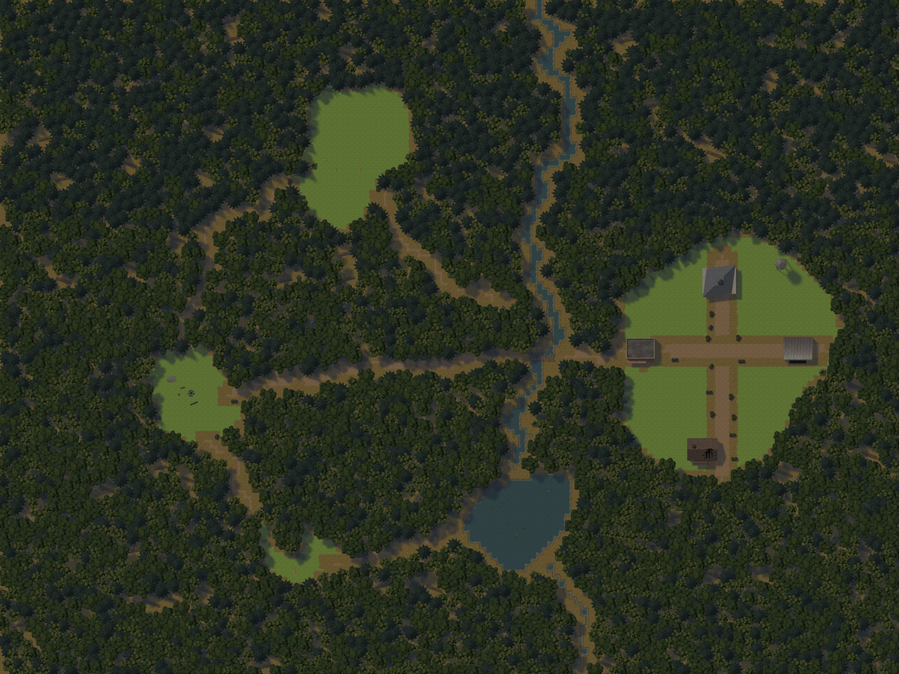

# The Forest World (Windows)

The world Wren will live in: dense woodland, clearings, a winding stream that feeds a pond,
mossy rocks, fallen logs, mushrooms, berry bushes, animal tracks, the campsite, the old
footbridge, and the abandoned town. Wren hasn't spawned yet; this is only the world.



## 1. Build it

Everything is rebuilt by one PowerShell command from the repo root:

```powershell
winget install BlenderFoundation.Blender      # once
winget install Python.Python.3.12              # once (the world builder is plain Python)
.\blender\render_all.ps1
```

| Step | Script | Output |
|------|--------|--------|
| tiles | `blender\render_tiles.py` | `renders\tiles\forest_atlas.png` + `.json` |
| objects | `blender\render_objects.py` | `renders\sprites\*.png` + `sprites.json` |
| wildlife | `blender\render_wildlife.py` | `renders\wildlife\*.png` + `wildlife.json` |
| world | `world_data\build_world.py` | `world_data\terrain.txt`, `objects.json`, `places.json`, `wildlife.json`, `world.json` |
| preview | `blender\render_preview.py` | `renders\preview\*.png`, `tile_choices.json` |

Run a subset with `-Only tiles,preview`, or make a different world layout with
`-Seed 12345`. Blender runs in the background on your GPU. All outputs are already
committed, so you only need to run this to change something.

## 2. Look and lighting

- Pre-rendered top-down in Blender (EEVEE, AgX), procedural materials only, so no outside
  art is used.
- **1 tile = 64 px = 2 m.** The camera looks straight down (image-up = north).
- The sun is 30° off vertical from the **north-west**, so shadows fall south-east. A faint
  canopy-dappled light is the same in every render.
- Every texture is *tile-periodic* (noise sampled on a torus), and tile edges follow fixed
  rules, so any tile meets any other without a seam. Measured on a test map, the colour
  step across a tile boundary is the same as between neighbouring pixels inside a tile
  (ratio 1.00 horizontally, 1.11 vertically).

## 3. Terrain tiles (Godot terrain autotiling)

One terrain set in **Match Corners and Sides** mode:

| id | terrain | walkable | notes |
|----|---------|----------|-------|
| 0 | forest_floor | yes | leaf litter, moss; 6 variants |
| 1 | water | no | shallow edges, deep centre, mud bank to the floor |
| 2 | path | yes | packed dirt, animal tracks |
| 3 | grass | yes | clearings |

- Each of water, path and grass has a **47-tile blob set** against forest floor, with **2
  shoreline variants per edge tile** (Godot picks between them at random) and 4 variants of
  the full tile.
- **Rule:** transitions exist only between forest floor and the others, so water, path and
  grass never touch each other directly. `build_world.py` enforces this, and the bridge
  sprite spans the floor gap where the trail meets the stream.
- `forest_atlas.json` lists every atlas cell with its terrain, peering bits (using
  `TileSet.CellNeighbor` names), probability and variant.
- **Verified:** for the whole map, the tile chosen by our code and the tile Godot's own
  terrain painter (`set_cells_terrain_connect`) chooses have identical terrain and peering
  bits on 19,197 of 19,200 cells. The 3 differences are on the map border, where we
  deliberately draw no shoreline.

## 4. Objects and places

Trees (oak, pine, birch, dead snag), berry bushes, ferns, mushrooms, mossy rocks, fallen
logs and lily pads are **separate sprites**, never baked into tiles. So are the named
places from the architecture docs:

| Place | What is there |
|-------|---------------|
| campsite | fire pit, half-collapsed tent, bedroll, backpack, log seat |
| trail | worn path from the campsite east to the stream and on to the town |
| bridge | old plank footbridge, two planks missing (truth: integrity 0.25) |
| stream / pond | the stream runs in from the north and feeds the pond (deep, lily pads) |
| north meadow / south glade | grass clearings where deer and rabbits feed |
| town | town hall, general store, garage, farmhouse (hole in the roof), water tower |

`world_data\places.json` holds these as **internal** names for tools and debugging. Wren
never receives them; it perceives appearances and names places itself
(`docs/architecture/00` W3).

## 5. Machine-readable meaning (for Wren's perception later)

Every terrain type, object sprite and animal carries a `meaning` block:

```json
"meaning": {
  "kind": "structure", "place": "bridge",
  "truth": {"integrity": 0.25, "walkable": true, "may_collapse": true},
  "affordances": ["cross", "repair"],
  "appearance": {"look": ["old plank footbridge"],
                 "inspect": ["planks soft and spongy", "two planks missing"]}
}
```

- **`truth`** is world truth. Only the world simulation reads it (it decides whether the
  bridge holds). **Wren's mind never sees it.**
- **`appearance`** is what perception may reveal, keyed by fidelity (`glimpse`, `look`,
  `inspect`, `hear`). Perception (Phase 1) turns these into percepts. That's how Wren can
  believe the bridge looks fine and be wrong.
- **`affordances`** are what can physically be attempted. Whether Wren *knows* it can is a
  belief.
- Hidden facts live only in `truth`: which mushrooms are toxic, which berries are
  edible, that the tower tank is empty.

## 6. Wildlife

Fish, rabbits, deer, songbirds, squirrels and frogs are world entities (not minds) with
simple, real-animal habits. Behaviour settings are in `renders\wildlife\wildlife.json`.

| Animal | Habits |
|--------|--------|
| deer | small herds; graze clearings at dawn and dusk; walk to the water to drink at dusk; flee at 22 m, and the herd flees together |
| rabbit | dawn and dusk; graze near clearings; bolt at 9 m |
| squirrel | daytime; near trees; at 7 m runs up the nearest tree and hides |
| songbird | perch in tree crowns, forage on the ground; fly to another tree at 6 m; sing at dawn and dusk |
| frog | night; on the shore; at 2.5 m hops into the water and dives; croak at night |
| fish | in the stream and pond; dart to deeper water when someone comes within 4 m of them |

Sprites face north and Godot rotates them to their heading. Their soft shadow is drawn
separately so it always falls south-east. Small animals are drawn slightly larger than life
(`display_scale`) so they stay readable at normal zoom. Birdsong and croaking are emitted
as world events (`WildlifeSystem.animal_sound`) for Wren's hearing later.

**Verified headless** on the real map: after 6 game hours no animal had left its habitat,
65 of 66 had moved, and each species reacted to the survivor as described above (deer
40 m, rabbit 25 m, bird 28 m to another tree; squirrel, frog and fish hid).

## 7. Godot integration

The Godot scripts live in `integration\godot\` with the same folder layout as your Godot
project. Copy that folder over `godot\`, then copy the generated content:

| Copy from (repo) | To (Godot project) |
|------------------|--------------------|
| `renders\tiles\`, `renders\sprites\`, `renders\wildlife\` | `godot\art\tiles\`, `godot\art\sprites\`, `godot\art\wildlife\` |
| `world_data\terrain.txt`, `objects.json`, `places.json`, `wildlife.json` | `godot\world\forest\` |

**What changes from the Phase 0 guide:** this replaces step 07b's shader terrain with the
TileMapLayer world.
- `SimUnits.PIXELS_PER_METRE` is now **32** (64 px tiles = 2 m).
- `SimTerrain` reads `terrain.txt`.
- `WorldObjects` holds every object (truth).
- Navigation includes object obstacles (trunks, rocks, logs at their real angle, buildings).
- New views: `TerrainTiles2D` (the TileMapLayer), `ObjectLayer2D`, `AnimalView2D`.
- The survivor spawns at the campsite (`View2D` position 2240, 4480).
- Delete the old `views\view2d\terrain_view_2d.gd`, `tree_layer_2d.gd` and
  `terrain.gdshader`.

Draw order (z-index): tiles 0 · lily pads and fish 1 · ground objects 2 · buildings 3 ·
survivor and land animals 4 · tree canopies 6 (they fade when the survivor walks
underneath) · birds when up in the trees or flying 7.

To paint terrain by hand in the editor, save the generated TileSet once:
`ForestTileSet.save_resource("res://art/tiles/forest_atlas.png", "res://art/tiles/forest_atlas.json", "res://art/tiles/forest_tileset.tres")`.
Your painting will match the generated map (see §3).

When exporting the game, add `*.json, *.txt` to **Export → Resources → Filters to export
non-resource files**.

## 8. Changing the world

- **Layout:** edit `world_data\terrain.txt` in Notepad (`.` forest floor, `~` water,
  `=` path, `,` grass, `B` bridge deck), or rerun the builder with another `-Seed`. Then
  rerun `-Only preview` and copy the files to Godot.
- **Look:** change materials in `blender\build_scene.py` (tiles) or
  `blender\render_objects.py` (sprites), then rerun those steps.
- **Tile size:** `TILE_PX` at the top of `build_scene.py`. Then set
  `SimUnits.PIXELS_PER_METRE = TILE_PX / 2` in Godot.
